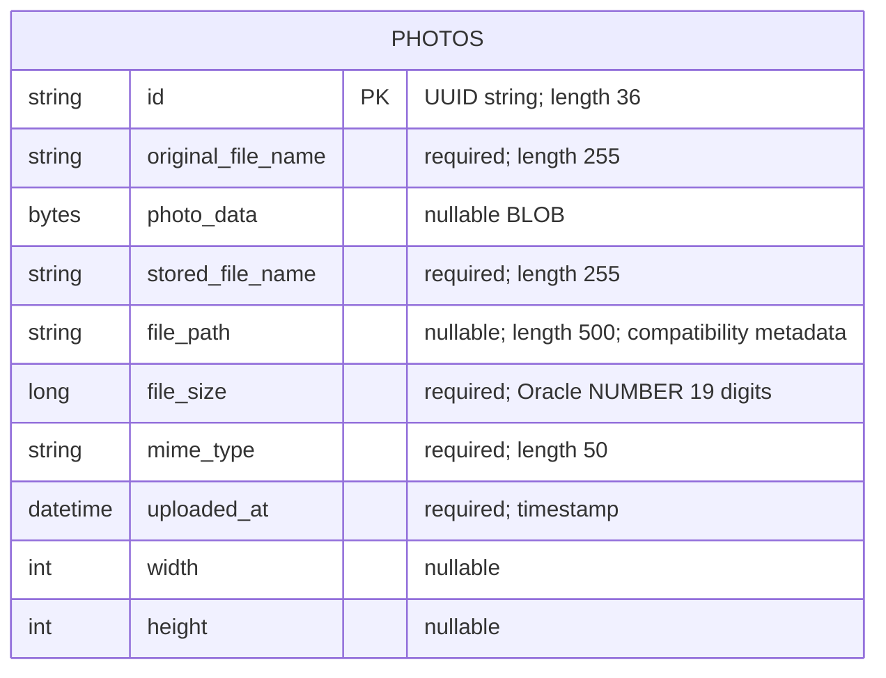

# Data Architecture & Persistence Layer

The data layer contains one JPA entity, `Photo`, persisted through Spring Data JPA/Hibernate to Oracle; H2 is configured for tests. Image bytes and metadata share the same database row rather than separate object storage (`pom.xml:43-54,88-93`; `src/main/java/com/photoalbum/model/Photo.java:15-91`).

## Database Configuration

| Service/Module | DB Type | Profile | Driver | Connection | Migration Tool |
|---|---|---|---|---|---|
| Photo Album | Oracle | Default | `com.oracle.database.jdbc:ojdbc8`; `oracle.jdbc.OracleDriver` | Environment-overridable Oracle Thin connection to the configured host, listener and pluggable database; credentials externalized, values omitted. Hibernate recreates schema at startup. | No Flyway/Liquibase declared; Hibernate-generated schema. |
| Photo Album | Oracle | `docker` | Same Oracle driver | Same environment-overridable connection; Hibernate also recreates schema at startup. | Same Hibernate schema generation; Oracle initialization scripts manage account privileges, not versioned entity migrations. |
| Photo Album tests | H2, in memory | `test` | Test-scoped `com.h2database:h2`; `org.h2.Driver` | Ephemeral named in-memory database; Hibernate creates schema and drops it on shutdown. Credential values omitted. | No migration tool; Hibernate schema generation. |

Sources: `src/main/resources/application.properties:9-21`; `src/main/resources/application-docker.properties:1-17`; `src/test/resources/application-test.properties:1-10`; `pom.xml:30-101`. The context test explicitly activates `test` (`src/test/java/com/photoalbum/PhotoAlbumApplicationTests.java:7-13`).

- No explicit connection-pool sizing, timeout tuning, or alternative pool provider is present in those datasource files. The JPA starter normally supplies HikariCP through its dependency chain; no explicit Hikari configuration or resolved dependency report was found in the inspected source.
- Oracle scripts grant schema-scoped creation privileges and tablespace quota, then verify the account; they do not create or seed `photos` (`oracle-init/01-create-user.sql:14-30`; `oracle-init/02-verify-user.sql:4-12`). No schema/data/import SQL scripts were found under `src`, and no programmatic seeding was found in the inspected Java source.
- Startup schema recreation is destructive rather than a versioned migration strategy. H2 context loading alone does not establish Oracle-query portability: repository SQL uses Oracle `ROWNUM`, `NVL`, and `TO_CHAR`, and the entity includes Oracle-specific column definitions (`src/main/java/com/photoalbum/repository/PhotoRepository.java:34-87`; `src/main/java/com/photoalbum/model/Photo.java:61-79`).

See `configuration-inventory.md` for the property inventory; this assessment intentionally omits raw connection and credential values.

## Data Ownership per Service

| Service | Tables Owned | ORM Framework | Caching | Notes |
|---|---|---|---|---|
| Photo Album (`photo-album` Maven module) | `photos` | JPA/Hibernate via `JpaRepository<Photo, String>` | No explicit application cache or Hibernate second-level/query cache found | Owns both photo BLOBs and metadata; identifiers are application-generated UUID strings. |

Sources: `pom.xml:15-18,43-54`; `src/main/java/com/photoalbum/model/Photo.java:15-26,93-108`; `src/main/java/com/photoalbum/repository/PhotoRepository.java:15-16`.

## Entity Model

`Photo` maps to `photos` and defines a non-unique upload-timestamp index. All ten persistent fields appear above; Java types are `String`, `byte[]`, `Long`, `LocalDateTime`, and nullable `Integer` dimensions (`src/main/java/com/photoalbum/model/Photo.java:15-91`). Nullability and lengths in the diagram describe database mappings, not the separate business validation rules.

The constructor generates the UUID and application timestamp; the timestamp column also declares an Oracle current-timestamp default. There is no generated sequence identifier, foreign key, association mapping, cascade, relationship fetch strategy, or optimistic-lock version field in this entity (`src/main/java/com/photoalbum/model/Photo.java:24-97`). `photoData` has `@Lob` but no explicit lazy-fetch annotation; native listing queries select the BLOB along with metadata (`src/main/java/com/photoalbum/model/Photo.java:36-41`; `src/main/java/com/photoalbum/repository/PhotoRepository.java:22-27`). The diagram has no relationship edges because no second persisted entity exists; none are inferred from filenames.

`UploadResult` is an unannotated response object, not another database entity (`src/main/java/com/photoalbum/model/UploadResult.java:3-10`).

Transactions are declared at `PhotoServiceImpl` class scope, with read-only overrides for listing, ID lookup, and previous/next lookups. Upload and delete inherit the class transaction; upload catches persistence exceptions internally, so a returned result is not proof of successful transaction commit (`src/main/java/com/photoalbum/service/impl/PhotoServiceImpl.java:28-30,53-75,172-193,198-217,223-237`).

## Key Repository Methods

All custom methods belong to `PhotoRepository extends JpaRepository<Photo, String>` at `src/main/java/com/photoalbum/repository/PhotoRepository.java:15-16`. Standard CRUD methods are inherited; the service uses `findById`, `save`, and `delete` (`src/main/java/com/photoalbum/service/impl/PhotoServiceImpl.java:69-71,172-174,198-210`).

| Service | Repository | Notable Methods | Purpose |
|---|---|---|---|
| Photo Album | `PhotoRepository` | `List<Photo> findAllOrderByUploadedAtDesc()` | Native full-row listing, including BLOB, newest first. Source: repository lines 22-27. |
| Photo Album | `PhotoRepository` | `List<Photo> findPhotosUploadedBefore(LocalDateTime uploadedAt)` | Native older-than timestamp query, descending order, at most ten rows via Oracle `ROWNUM`. Source: lines 34-42. |
| Photo Album | `PhotoRepository` | `List<Photo> findPhotosUploadedAfter(LocalDateTime uploadedAt)` | Native newer-than timestamp query, ascending order; substitutes a value for null compatibility paths with `NVL`; no row limit. Source: lines 49-56. |
| Photo Album | `PhotoRepository` | `List<Photo> findPhotosByUploadMonth(String year, String month)` | Native timestamp filtering through Oracle `TO_CHAR`, newest first. Source: lines 64-71. |
| Photo Album | `PhotoRepository` | `List<Photo> findPhotosWithPagination(int startRow, int endRow)` | Native nested `ROWNUM` pagination with inclusive row bounds. Source: lines 79-87. |
| Photo Album | `PhotoRepository` | `List<Object[]> findPhotosWithStatistics()` | Raw native projection containing photo columns, descending-size rank, and running byte totals. Source: lines 93-100. |

All custom queries use `@Query(nativeQuery = true)`; there are no custom derived finders, stored-procedure calls, or cross-service bulk aggregation methods in this interface. The inspected service invokes listing and timestamp-neighbor queries, but not month filtering, pagination, or statistics (`src/main/java/com/photoalbum/service/impl/PhotoServiceImpl.java:53-75,223-237`).

## Caching Strategy

| Layer | Observed strategy | Provider / TTL / eviction |
|---|---|---|
| Application/repository | Reads call the repository directly; no cache-aside, read-through, or write-through implementation found. | No explicit Redis, Ehcache, Caffeine, Spring Cache, or JCache dependency/configuration found. |
| ORM | Ordinary JPA persistence-context behavior; no explicit second-level or query cache configuration found. | No configured cache regions, TTLs, or eviction policies. |
| Photo responses | Explicitly requests no storage or reuse by HTTP caches. | No-cache/no-store headers and immediate expiry; this is not a data cache. |
| Authentication sessions | Stateless security configuration; no session-cache layer configured. | In-memory administrator identity, not a persisted entity or distributed session store. |

Evidence: `pom.xml:30-101`; all three application property files cited above; `src/main/java/com/photoalbum/service/impl/PhotoServiceImpl.java:53-75,223-237`; `src/main/java/com/photoalbum/controller/PhotoFileController.java:74-83`; `src/main/java/com/photoalbum/config/SecurityConfig.java:28-42,46-60`. No cache rationale is documented; no rationale is inferred.

## Data Ownership Boundaries

The inspected Maven project defines one application module, one entity and one repository, not multiple independently owned databases. Metadata and image contents are colocated in the same application schema and row; test execution substitutes an isolated ephemeral H2 database (`pom.xml:15-18`; `src/main/java/com/photoalbum/model/Photo.java:15-91`; `src/test/resources/application-test.properties:1-9`).

The service accesses its own database through `PhotoRepository`; there is no cross-service database access, remote data aggregation, or separate command/read-store implementation in the inspected persistence layer. Reads and writes share the same entity and repository. Image content is read into a byte array and saved as a BLOB; the stored path and generated filename are compatibility metadata, not evidence of an active filesystem-backed image store (`src/main/java/com/photoalbum/service/impl/PhotoServiceImpl.java:112-124,160-174,198-210`). Serving reads the BLOB from the entity rather than reading that path (`src/main/java/com/photoalbum/controller/PhotoFileController.java:44-69`).

### Data Classification & Sensitivity

| Entity | Sensitive Fields | Classification (PII/PHI/PCI/None) | Controls in Place |
|---|---|---|---|
| `Photo` | `photoData`; potentially `originalFileName` | Potential PII: uploaded images may identify people or retain embedded metadata, and filenames may contain personal information. No explicit PHI/PCI fields are modeled; arbitrary image content cannot be classified from code alone. | Mutations require authentication, but reads are public; no per-photo owner or field-level access controls. No application-level field encryption, masking, or metadata stripping found; database encryption-at-rest is not established by the inspected configuration. |
| `Photo` | `id`, `storedFileName`, `filePath`, `fileSize`, `mimeType`, `uploadedAt`, `width`, `height` | No explicit PII/PHI/PCI fields; identifiers, paths and timestamps can become identifying when associated with sensitive images. | Generated UUID identifiers; the same entity-level access policy applies. No field-level masking/encryption found. |

Evidence: raw upload bytes are retained (`src/main/java/com/photoalbum/service/impl/PhotoServiceImpl.java:112-130,160-174`); metadata mappings contain no owner field (`src/main/java/com/photoalbum/model/Photo.java:24-91`); public reads and authenticated mutations are configured in `src/main/java/com/photoalbum/config/SecurityConfig.java:46-60`. Photo responses suppress caching, but filenames and partial binary content are logged, which is not masking (`src/main/java/com/photoalbum/controller/PhotoFileController.java:53-66,74-83`). Oracle initialization limits grants to the application schema and sets quota, but does not configure encryption (`oracle-init/01-create-user.sql:14-30`). Administrator credentials are externalized and BCrypt-encoded in memory; no credential values are reproduced here (`src/main/java/com/photoalbum/config/SecurityConfig.java:28-42`).
