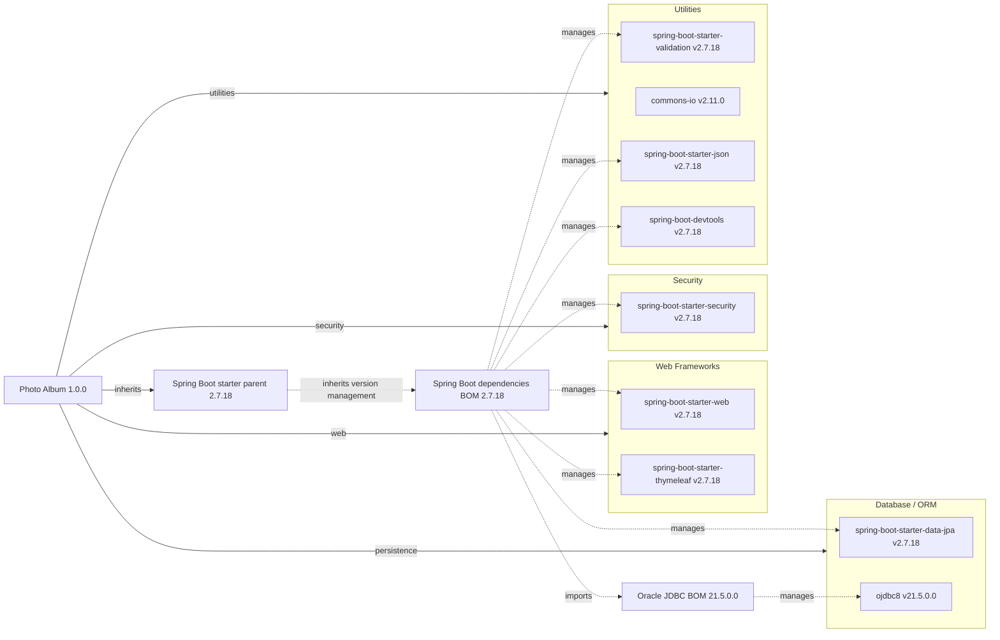

# Dependency Map

Photo Album (`com.photoalbum:photo-album:1.0.0`) is a single Maven JAR project declaring **11 external dependencies: 9 non-test and 2 test-scoped**. Counts exclude its parent POM, inherited BOMs, build plugins, and transitive libraries; project identity is declared in [pom.xml:15–21](../../../../../../pom.xml#L15-L21).

## Dependencies

### Dependency Summary

| Category | Count | Key Libraries | Notes |
|----------|-------|---------------|-------|
| Web Frameworks | 2 | `org.springframework.boot:spring-boot-starter-web:2.7.18`; `org.springframework.boot:spring-boot-starter-thymeleaf:2.7.18` | Default compile scope; inherited versions. [pom.xml:31–41](../../../../../../pom.xml#L31-L41). |
| Database / ORM | 2 | `org.springframework.boot:spring-boot-starter-data-jpa:2.7.18`; `com.oracle.database.jdbc:ojdbc8:21.5.0.0` | JPA default compile scope; Oracle explicitly runtime scope. [pom.xml:43–54](../../../../../../pom.xml#L43-L54). |
| Security | 1 | `org.springframework.boot:spring-boot-starter-security:2.7.18` | Default compile scope; inherited version. [pom.xml:62–66](../../../../../../pom.xml#L62-L66). |
| Utilities | 4 | `org.springframework.boot:spring-boot-starter-validation:2.7.18`; `commons-io:commons-io:2.11.0`; `org.springframework.boot:spring-boot-starter-json:2.7.18`; `org.springframework.boot:spring-boot-devtools:2.7.18` | Default compile scope; only Commons IO has an explicit local version. DevTools is optional. [pom.xml:56–79](../../../../../../pom.xml#L56-L79), [95–100](../../../../../../pom.xml#L95-L100). |
| **Total non-test** | **9** | | Includes optional development tooling; does not imply nine production runtime libraries. |

**Version-management evidence:** The local POM declares `org.springframework.boot:spring-boot-starter-parent:2.7.18`, with no local BOM import or version overrides for the starters, Oracle, or H2 ([pom.xml:8–13](../../../../../../pom.xml#L8-L13), [23–101](../../../../../../pom.xml#L23-L101)). Managed versions above are corroborated by the published [Spring Boot 2.7.18 dependency-management POM](https://repo.maven.apache.org/maven2/org/springframework/boot/spring-boot-dependencies/2.7.18/spring-boot-dependencies-2.7.18.pom); Oracle's version follows its imported [Oracle JDBC 21.5.0.0 BOM](https://repo.maven.apache.org/maven2/com/oracle/database/jdbc/ojdbc-bom/21.5.0.0/ojdbc-bom-21.5.0.0.pom), which sets `version.lib.ojdbc=21.5.0.0`. Versions are managed defaults, not results from an executed Maven dependency resolution.

**Build boundary:** Java 8 source/target and `java.version=1.8` are explicitly configured ([pom.xml:23–28](../../../../../../pom.xml#L23-L28)). The sole locally declared build plugin is `org.springframework.boot:spring-boot-maven-plugin`, with an inherited version rather than an explicit local version ([pom.xml:103–109](../../../../../../pom.xml#L103-L109)); it is not counted as an application dependency. No Maven/Gradle multi-module declaration or recognized package lockfile was found. Analysis inspected build/package files only; no source inspection or build/test execution was performed.

### Version & Compatibility Risks

Spring Boot 2.7.18 is the final 2.x open-source maintenance release and represents a legacy baseline; commercial support terms must be checked separately. Moving to Boot 3 requires Java 17 or newer and migration from Java EE `javax` APIs to Jakarta APIs, while this build explicitly targets Java 8 ([pom.xml:8–13](../../../../../../pom.xml#L8-L13), [23–28](../../../../../../pom.xml#L23-L28)). The inherited BOM still manages older framework families (Spring Framework 5.3.31, Hibernate 5.6.15.Final, and Spring Security 5.7.11); these are managed versions, not separately declared or verified resolved dependencies. Review the pinned Commons IO 2.11.0 and Oracle JDBC 21.5.0.0 during modernization. This dependency inventory is not a vulnerability scan and does not establish current CVE status.

### Notable Observations

- The parent centralizes nearly all versions; Commons IO alone is explicitly pinned locally, so its upgrade must be considered separately from parent upgrades ([pom.xml:8–13](../../../../../../pom.xml#L8-L13), [68–73](../../../../../../pom.xml#L68-L73)).
- `spring-boot-starter-json` is declared under an “Image processing” comment, but its artifact identifies JSON support, not an image-processing library. Web and JSON starters can overlap transitively; no resolved dependency tree was produced ([pom.xml:31–35](../../../../../../pom.xml#L31-L35), [75–79](../../../../../../pom.xml#L75-L79)).
- Oracle is runtime-scoped while H2 is test-scoped, indicating different database dependencies between runtime and tests; SQL/dialect equivalence cannot be inferred from declarations ([pom.xml:49–54](../../../../../../pom.xml#L49-L54), [88–93](../../../../../../pom.xml#L88-L93)).
- DevTools is optional but has default compile scope, not runtime scope. Its presence is development tooling, and it remains included in the non-test declaration count ([pom.xml:95–100](../../../../../../pom.xml#L95-L100)). No direct messaging, caching, logging, or observability dependency is declared; starter-provided transitives are deliberately not counted.

## Test Dependencies

| Framework | Version | Notes |
|-----------|---------|-------|
| `org.springframework.boot:spring-boot-starter-test` | 2.7.18, parent-managed | Explicit test scope; testing starter rather than a single test framework. [pom.xml:81–86](../../../../../../pom.xml#L81-L86). |
| `com.h2database:h2` | 2.1.214, BOM-managed | Explicit test scope; embedded database for test infrastructure. Version from the published Boot BOM above. [pom.xml:88–93](../../../../../../pom.xml#L88-L93). |

Total test-scope dependencies: **2**

JUnit, Mockito, and other starter transitives are not individually declared here and are not counted as additional test dependencies; their resolved versions were not verified. No dedicated Testcontainers or contract-testing dependency is declared; H2 cannot by itself establish Oracle compatibility, and actual test coverage was not assessed.
