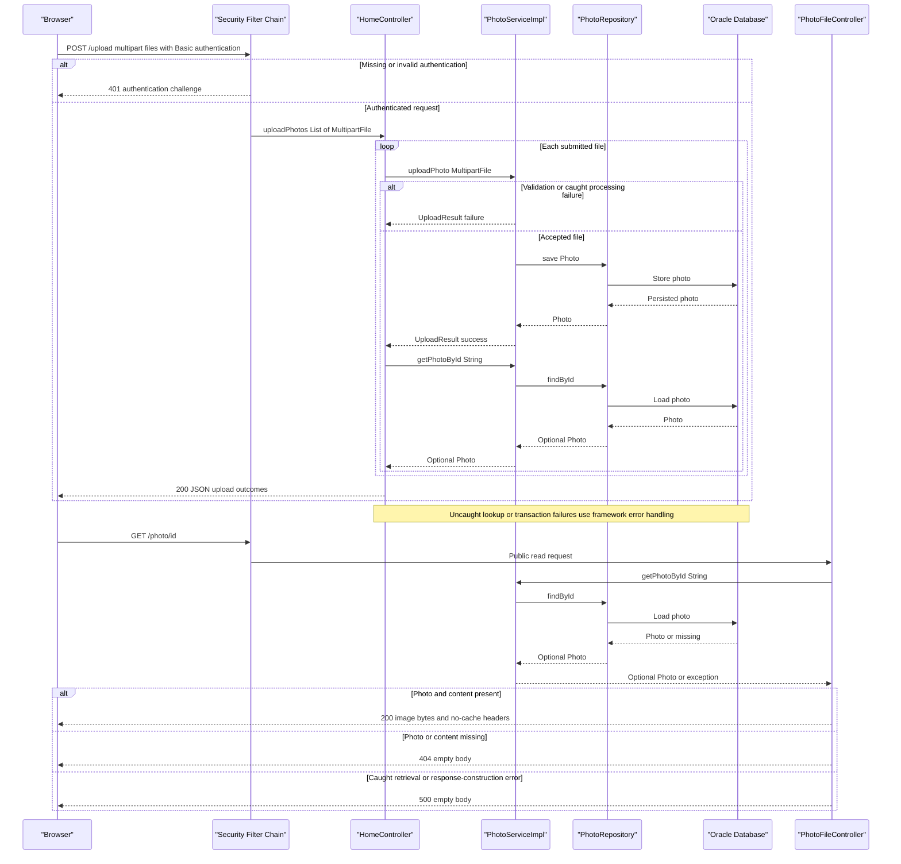

# API & Service Communication Contracts

The application exposes five explicit HTTP controller endpoints: two HTML views, one JSON multipart-upload operation, one deletion action, and one binary-image response. Requests use synchronous controller-to-service calls; no asynchronous messaging or inter-service HTTP API is implemented.

## Service Catalog

| Service | Port | Category | Purpose |
|---|---|---|---|
| `photoalbum-java-app` / Maven `com.photoalbum:photo-album` | HTTP 8080; Compose publishes 8080 | API Layer / Business | Single source-built application serving gallery pages, upload, deletion, and image content. Dependencies include Spring Boot Web, Thymeleaf, Data JPA, Validation, Security, JSON, and Oracle JDBC. |
| `oracle-db` | TCP 1521; Compose publishes 1521 | Infrastructure | Third-party Oracle Free container providing the application's database connection; not an HTTP API service. |
| Azure infrastructure declared by `azure-setup.ps1` | PostgreSQL conventionally uses TCP 5432; no application ingress declaration in this script | Infrastructure | Provisioning script declares AKS, a container registry, and a PostgreSQL flexible server. These are not additional source-built modules or implemented API services; the inspected application uses Oracle JDBC, so the script alone does not establish a working PostgreSQL application contract. |

`pom.xml` defines one executable JAR and no Maven submodules. `docker-compose.yml` defines only the application and Oracle services. Azure infrastructure declarations are provisioning intent, not evidence of deployed services or live endpoints.

Evidence: `pom.xml:8-17,30-101`; `docker-compose.yml:1-43`; `Dockerfile:22-31`; `azure-setup.ps1:69,85,117`.

## API Endpoints Inventory

All paths are unversioned; no URL-, header-, or query-based API versioning is defined. Status codes below describe explicit handlers or standard framework behavior, not a live-service verification.

| Service / Controller | Method | Path | Request Type | Response Type |
|---|---|---|---|---|
| Photo Album / `HomeController` | GET | `/` | No required parameters | 200 HTML `index` view, backed by `List<Photo>` and a timestamp; retrieval errors are caught and render an empty gallery rather than an application-defined error response. |
| Photo Album / `HomeController` | POST | `/upload` | `multipart/form-data`; required repeated `files` parts bound to `List<MultipartFile>`; HTTP Basic authentication | 200 JSON `Map<String,Object>` containing aggregate success and per-file outcomes; explicit 400 JSON for an empty list; missing required parts normally produce framework 400; absent/invalid authentication normally produces 401. |
| Photo Album / `DetailController` | GET | `/detail/{id}` | String path parameter `id` | 200 HTML `detail` view backed by `Photo` and previous/next identifiers; normally 302 redirect to `/` for missing photo or caught lookup/navigation errors. |
| Photo Album / `DetailController` | POST | `/detail/{id}/delete` | String path parameter `id`; no request DTO; HTTP Basic authentication | Normally 302 redirect to `/` with success/error flash attribute, including not-found and caught failure cases; absent/invalid authentication normally produces 401. |
| Photo Album / `PhotoFileController` | GET | `/photo/{id}` | String path parameter `id`; browser may append an ignored cache-busting query parameter | 200 `ResponseEntity<Resource>` containing image bytes with stored MIME type; empty-body 404 for missing photo/content, empty-body 500 on caught exceptions. |

**Upload response semantics**

- Successful request processing returns 200 even if every file is rejected; clients must inspect `success`, `uploadedPhotos`, and `failedUploads`. `success` is true only when at least one uploaded photo is included in the response.
- Uploaded items are controller-created metadata maps, not serialized `Photo` entities. Failed items contain `fileName` and `error`; the empty-list 400 envelope instead contains `success: false` and `error`.
- Per-file validation failures are represented as failed items, not individual HTTP 400 responses. Multipart parser failures occur before this handler and do not have a controller-defined JSON envelope or custom oversized-request status mapping.
- After a successful service upload, the controller performs another lookup. If it returns empty, that item appears in neither list; an exception in that lookup is not caught by the controller and can escape to framework error handling. Transaction failures can also escape the service boundary; there is no global custom exception contract.
- Returned compatibility paths beginning `/uploads/` are not the implemented database-backed image endpoint; clients use `/photo/{id}`.

**Image response headers:** `Cache-Control: no-cache, no-store, must-revalidate, private`, `Pragma: no-cache`, `Expires: 0`, and `X-Photo-ID`, `X-Photo-Name`, `X-Photo-Size`. No range-download, conditional-GET, or pagination contract is explicitly implemented.

Static resources under `/css/`, `/js/`, and the packaged `/uploads/` directory are framework-served assets, not additional controller operations. Spring MVC's implicit HEAD/OPTIONS behavior and Boot's default error handling are not counted among the five explicit mappings.

Evidence: `src/main/java/com/photoalbum/controller/HomeController.java:37-97`; `src/main/java/com/photoalbum/controller/DetailController.java:18-78`; `src/main/java/com/photoalbum/controller/PhotoFileController.java:23-86`; `src/main/resources/static/js/upload.js`.

## Management & Observability Endpoints

| Service | Endpoint | Custom Metrics (if any) |
|---|---|---|
| Photo Album | No Actuator, dedicated HTTP health, Swagger UI, or metrics endpoint declared | No custom metric registration, timing annotation, or metrics exporter found. |
| Oracle container | No application HTTP management endpoint; container health is checked locally | No application-level metrics contract declared. |

The application uses SLF4J logging rather than an exposed observability API. Boot's framework `/error` handling is not a custom management endpoint. Container startup checks are covered by `configuration-inventory.md`, not a separate public health contract.

Evidence: `pom.xml:30-101`; controller and service imports; `docker-compose.yml:17-22`.

## DTOs & Contracts

| Class / Type | Contract role | Mutability |
|---|---|---|
| `Photo` | Service-owned domain entity supplied to HTML views and used to build upload metadata responses; not accepted as a JSON request or directly returned as the upload JSON body | Mutable POJO with setters |
| `UploadResult` | Internal service-to-controller outcome for each upload; converted into the public JSON envelope rather than returned directly | Mutable POJO with setters |
| `MultipartFile` / `List<MultipartFile>` | Framework abstraction for multipart request parts | Framework-managed interface; not an immutable application DTO |
| `Map<String,Object>` / lists of maps | Public upload response envelope and item projections; no dedicated response class or formally versioned schema | Mutable collections |
| `Resource` implemented by `ByteArrayResource` | Binary image response body, not JSON/base64 | Framework resource abstraction; no immutable application DTO guarantee |

There are no gateway aggregation DTOs, Java records, or immutable application request/response classes. Entity field definitions and persistence details belong in `data-architecture.md`; individual validation constraints belong in `business-workflows.md`.

Spring's Jackson HTTP message conversion serializes the upload maps, including projected temporal metadata. JSON support is declared in the build; no custom mapper, serializer, naming policy, date-format override, or application JSON annotations were found. HTML views use Thymeleaf; binary image content bypasses JSON serialization.

No OpenAPI/Swagger specification or integration, protobuf contract, or GraphQL schema was found in the application source. API contracts are defined by the controller signatures and map construction.

Evidence: `src/main/java/com/photoalbum/model/Photo.java`; `src/main/java/com/photoalbum/model/UploadResult.java`; `src/main/java/com/photoalbum/controller/HomeController.java:57-95`; `pom.xml:75-79`.

## Communication Patterns

- **Synchronous entry points:** browsers request HTML and image content over HTTP, submit multipart uploads using `fetch('/upload', ...)`, and submit deletion forms. Gallery/detail views request individual images from `/photo/{id}`.
- **Internal calls:** controllers invoke the injected `PhotoService`, implemented by `PhotoServiceImpl`, directly in the same process. The service invokes `PhotoRepository` synchronously; repository operations reach Oracle through JPA/JDBC. These are not separately deployed services.
- **External browser resources:** templates reference Bootstrap assets hosted on jsDelivr over HTTPS. This is a browser asset dependency, not a backend service-to-service API.
- **Asynchronous communication:** no queue, broker, pub/sub, background event workflow, or async service transport found. Browser `fetch` is asynchronous JavaScript but targets the same synchronous server endpoint.
- **Gateway / composition:** no gateway, BFF, or downstream-service aggregation exists. Upload outcomes are combined locally across files; detail navigation combines local service queries, not remote responses.
- **Discovery / balancing:** Compose provides DNS resolution for the configured Oracle hostname. No Eureka/Consul registration, logical-name HTTP discovery client, or application client-side load balancing is implemented.
- **Resilience:** no retry policy, circuit breaker, bulkhead, fallback service, or explicit application HTTP/JDBC query/connection timeout value is declared in the inspected source/configuration. Runtime/driver defaults are not inferred. Compose's restart-on-failure behavior is process recovery, not request retry.
- **Fallback behavior:** gallery lookup failure renders an empty page; detail lookup/navigation failure redirects home; deletion failure redirects home with a flash message; image retrieval failure returns 500; missing image/content returns 404. Upload validation and caught processing failures become per-file outcomes, although transaction-boundary and follow-up lookup failures can still escape to framework error handling.
- **Availability:** Compose starts the application after Oracle is healthy; database availability and required externally supplied credentials affect startup and subsequent request handling. See `configuration-inventory.md` for deployment settings and readiness details.
- **Authentication / authorization:** Spring Security applies stateless HTTP Basic authentication to POST `/upload` and POST `/detail/*/delete`. Other requests, including gallery, detail, and image reads, are permitted anonymously. The configured user has an ADMIN role, but the matchers require only authentication, not an ADMIN-role check. No JWT, OAuth2, method-level authorization, or per-photo ownership checks are implemented.
- **Transport / browser security contract:** the application/container exposes HTTP 8080; no application TLS listener or forced HTTPS redirect is configured. TLS termination by external infrastructure is not established by these sources. CSRF protection is explicitly disabled, sessions are stateless, and no custom CORS policy is declared. Credential values are deliberately omitted.

Evidence: `src/main/java/com/photoalbum/config/SecurityConfig.java:28-61`; `src/main/java/com/photoalbum/service/impl/PhotoServiceImpl.java:50-237`; `src/main/java/com/photoalbum/repository/PhotoRepository.java:16-100`; `docker-compose.yml:25-44`; `src/main/resources/templates/`; application properties.

## Service Technology Matrix

| Service | Web | Data Access | Discovery | Gateway | Actuator / Health | Cache | Metrics |
|---|---|---|---|---|---|---|---|
| Photo Album | Spring MVC / Thymeleaf; JSON and binary responses | Spring Data JPA / Oracle JDBC | Compose DNS for database only | None | No Actuator or custom HTTP health endpoint | No application caching layer; image responses prohibit caching | Logging only; no exporter |
| Oracle container | No application HTTP API | Oracle SQL/JDBC server | Compose service DNS | None | Container-local health command | Not assessed as an application cache | No configured application exporter |
| Azure provisioning declarations | No implemented application endpoint in script | PostgreSQL server provisioned; no matching application driver declared | AKS infrastructure only; no application discovery contract established | Not declared | No application health contract established | Not declared | No application metrics contract established |

Evidence: `pom.xml`; `docker-compose.yml`; `azure-setup.ps1`; controller response construction.

## Service Communication Sequence

The primary upload-and-view flow includes authentication, per-file outcomes, and binary retrieval. Solid arrows denote synchronous calls; dashed arrows denote responses, not a message broker. No retry or circuit-breaker path exists to diagram.

