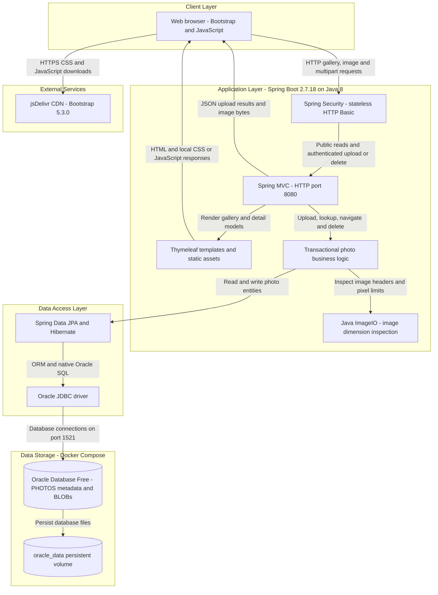
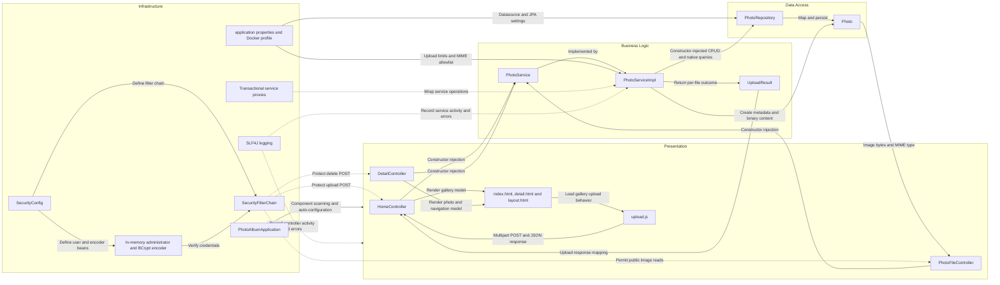

# Architecture Diagram

Photo Album is a single-module, server-rendered Spring Boot application for browsing, uploading, viewing, and deleting photos. The diagrams describe the implemented application and its Docker Compose deployment, not a proposed architecture.

## Application Architecture

### Technology Stack Summary

| Layer | Technology | Version | Purpose |
|---|---|---|---|
| Client | HTML, CSS, browser JavaScript and Bootstrap | Bootstrap 5.3.0 | Gallery, detail views, multipart uploads through Fetch, and responsive styling |
| Application | Java / Eclipse Temurin | Java 8 | Application language target and container runtime |
| Application | Spring Boot | 2.7.18 | Executable JAR, dependency management, configuration, and application bootstrap |
| Presentation | Spring MVC, embedded Tomcat, Thymeleaf | Managed by Spring Boot 2.7.18 | HTTP endpoints, server-side HTML rendering, static assets, and multipart handling |
| Security | Spring Security and BCrypt | Managed by Spring Boot 2.7.18 | Stateless HTTP Basic and an in-memory administrator account |
| Business logic | Spring transactions and Java ImageIO | Boot-managed transactions; Java 8 ImageIO | Photo lifecycle, upload validation, and image dimension inspection |
| Data access | Spring Data JPA, Hibernate, Oracle `ojdbc8` | Managed by Spring Boot 2.7.18 | Entity persistence, JDBC connectivity, and native Oracle queries |
| Storage | Oracle Database Free | Compose image `gvenzl/oracle-free:latest`; exact runtime version unpinned | Photo metadata and binary content in the `PHOTOS` table |
| Build and packaging | Maven and Docker multi-stage build | Builder Maven 3.9.6; runtime `eclipse-temurin:8-jre` | Build and run the executable application JAR |
| Test storage | H2 | Managed by Spring Boot 2.7.18; test scope only | Database dependency for tests, not the deployed application store |

### Data Storage & External Services

Oracle stores both photo metadata and image bytes (`Photo.photoData` is mapped as a large object in the `PHOTOS` table). Uploads do not write new image files to disk: stored filenames and `/uploads/` paths are compatibility metadata, while active gallery images are served through `/photo/{id}` from database bytes. Docker Compose places the application and database on a bridge network, waits for database health before starting the application, and persists Oracle data in the `oracle_data` volume. The configured Hibernate schema policy is `create`, so persistence of database files does not prevent schema recreation at application startup.

The browser downloads Bootstrap CSS and JavaScript from jsDelivr. No application-level cache, message broker, object-storage service, or external business API is configured in the inspected source. Database and administrator credentials are supplied through environment-backed configuration; no credential values are reproduced here.

### Key Architectural Decisions

- A layered monolith separates MVC controllers, a constructor-injected service interface and implementation, and a Spring Data repository. Service-level transactions use read-only overrides for lookups and navigation.
- Images and metadata share the Oracle database rather than separate file or object storage. Native queries use Oracle-specific features including `ROWNUM`, `NVL`, `TO_CHAR`, and analytical functions.
- Gallery and image reads are public; upload and delete POST endpoints require HTTP Basic authentication using an environment-configured, BCrypt-encoded in-memory administrator. Security is stateless and CSRF protection is disabled in the current configuration.

## Component Relationships

### Component Inventory

| Component | Layer | Type | Responsibility |
|---|---|---|---|
| `HomeController` | Presentation | MVC controller | Serves `GET /`, accepts multipart `POST /upload`, and maps per-file results into JSON |
| `DetailController` | Presentation | MVC controller | Serves `GET /detail/{id}`, supplies adjacent-photo navigation, and handles `POST /detail/{id}/delete` |
| `PhotoFileController` | Presentation | MVC binary-response controller | Serves database-backed image bytes at `GET /photo/{id}`, with MIME type and no-cache headers |
| `index.html`, `detail.html`, `layout.html` | Presentation | Thymeleaf templates | Define gallery, detail, navigation, deletion form, and shared layout markup |
| `upload.js` and `site.css` | Presentation | Static browser assets | Upload interaction, gallery updates, and application styling |
| `PhotoService` | Business logic | Service interface | Defines photo listing, retrieval, upload, deletion, and adjacent-photo navigation |
| `PhotoServiceImpl` | Business logic | Transactional service | Validates declared MIME type and file size, inspects image dimensions with a pixel limit, and delegates persistence |
| `UploadResult` | Business logic | Result model | Carries upload status, original filename, error message, and saved photo identifier |
| `PhotoRepository` | Data access | Spring Data JPA repository | Provides standard CRUD and native Oracle listing, navigation, month, pagination, and statistics queries; not every declared query is used by current controllers |
| `Photo` | Data access | JPA entity | Maps UUID identifier, metadata, dimensions, timestamp, compatibility path, and binary image data |
| `PhotoAlbumApplication` | Infrastructure | Spring Boot entry point | Starts the application and enables component scanning and auto-configuration |
| `SecurityConfig` | Infrastructure | Security configuration | Creates the password encoder, in-memory user manager, and request security filter chain |
| `SecurityFilterChain` | Infrastructure | Request filter chain | Applies stateless authentication rules and permits public read access |
| In-memory administrator and BCrypt encoder | Infrastructure | Authentication beans | Validate the configured administrator credentials without a database-backed user store |
| `application.properties`, `application-docker.properties` | Infrastructure | Externalized configuration | Configure the datasource, JPA, port, multipart limits, upload policy, and logging |
| Transactional service proxies | Infrastructure | Spring cross-cutting infrastructure | Apply transaction boundaries and read-only lookup semantics |
| SLF4J logging | Infrastructure | Cross-cutting logging | Records controller and service operations and failures |
| `MathUtil` | Utility | Standalone utility class | Provides greatest-common-divisor calculation; no use in the photo request flow was found |

Evidence: `pom.xml`, `Dockerfile`, `docker-compose.yml`, `src/main/resources/application*.properties`, `src/main/resources/templates/*.html`, `src/main/resources/static/js/upload.js`, and `src/main/java/com/photoalbum/{controller,service,repository,model,config,util}`.
