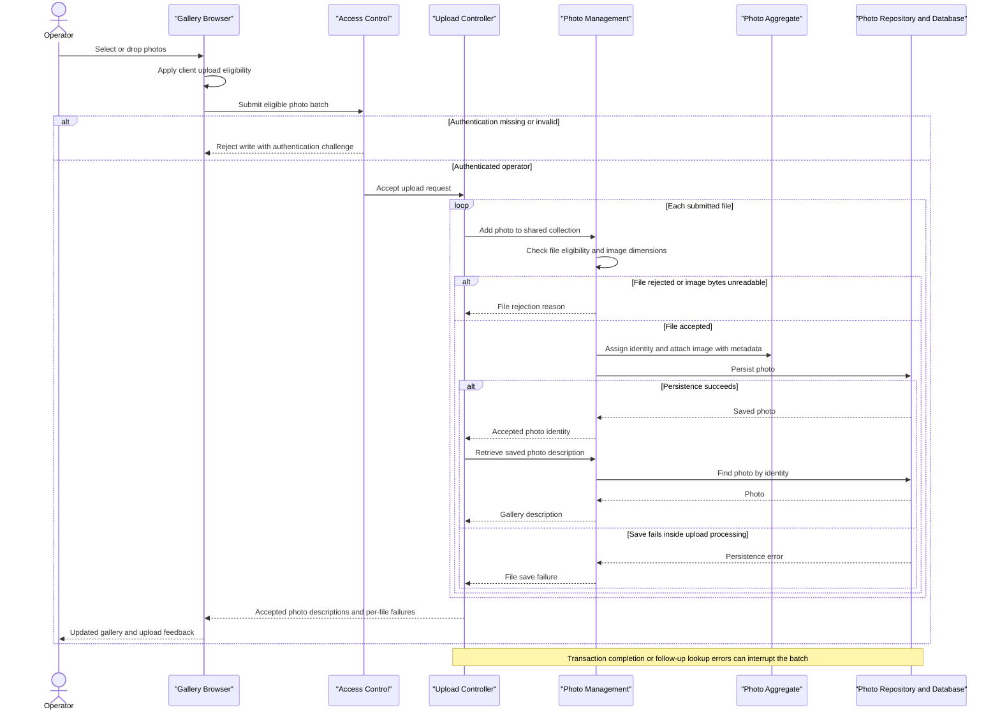

# Core Business Workflows

Photo Album lets visitors browse a shared photo gallery and inspect individual images. Authenticated operators can upload batches of photos and permanently remove photos from the collection.

## Domain Entities

| Entity | Service / Bounded Context | Description | Key Relationships |
|---|---|---|---|
| Photo | Photo Album / Photo Management | A stored image together with the descriptive information needed for gallery display and navigation. The only persisted business entity and the effective aggregate boundary. | Owns its image content and metadata; older and newer photos are selected by upload time, not by stored relationships. |
| UploadResult | Photo Album / Upload Processing | Transient outcome of one file upload, conveying acceptance or a user-facing rejection reason. Not a persisted entity. | References the created Photo on success; batch responses collect individual outcomes. |

There are no modeled album, photo-owner, tag, or user-to-photo relationships. The gallery is one shared collection rather than separate user-owned albums.

Evidence: `src/main/java/com/photoalbum/model/Photo.java:19-118`; `src/main/java/com/photoalbum/model/UploadResult.java:6-30`.

## Service-to-Domain Mapping

This is one application with internal components, not independently deployed domain services.

| Service | Domain Context | Owned Entities | External Dependencies |
|---|---|---|---|
| Photo Album (`HomeController`, `DetailController`, `PhotoFileController` → `PhotoServiceImpl` → `PhotoRepository`) | Shared photo collection, upload processing, viewing and removal | Photo; transient UploadResult | Photo database, with Oracle-specific repository queries; browser supplies files and requests image content. |
| Access control (`SecurityConfig`, internal supporting component) | Operator authentication and write access | In-memory operator identity; no persisted domain entity | Configured administrator credentials; actual credential values are intentionally omitted. |

`PhotoServiceImpl` is the internal business-operation boundary. `PhotoRepository` is the persistence gateway and the database is the source of truth for both photo descriptions and image content. Controllers share the same domain rather than exchanging copies between bounded contexts.

Evidence: `src/main/java/com/photoalbum/service/impl/PhotoServiceImpl.java:28-48`; `src/main/java/com/photoalbum/repository/PhotoRepository.java:15-56`; `src/main/java/com/photoalbum/config/SecurityConfig.java:33-61`.

## Primary Workflows

### Workflow 1: Upload a batch and publish accepted photos

Entry point: an operator selects or drops files in the gallery; the browser submits `POST /upload`.

1. The browser applies **Client upload eligibility** and submits eligible files together, displaying upload progress.
2. Access control applies **Authenticated writes** before the controller processes the request.
3. `HomeController` applies **Batch presence**, then invokes `PhotoService.uploadPhoto` sequentially for each supplied file.
4. `PhotoServiceImpl` applies **Server upload eligibility** and **Image dimensions**. It reads image bytes, derives optional dimensions, and generates a new photo identity, upload time and compatibility filename.
5. The service builds a Photo containing the image and its metadata and saves it through `PhotoRepository`. Compatibility paths are descriptive only; this flow does not write uploaded content to disk.
6. On reported success, the controller retrieves the saved Photo by ID to compose the gallery response. Rejected files contribute a filename and error to the failed-upload collection.
7. The response combines accepted-photo descriptions and per-file failures. The browser prepends accepted photos to the gallery, displays success/errors, and requests their image content separately.

**Outcome:** mixed batches can partially succeed; a rejected file does not normally prevent later files from being attempted. The operation is not an all-or-nothing batch. Transaction-completion failures or exceptions during the controller's follow-up lookup can still interrupt the request rather than become a normal per-file failure.

Evidence: `src/main/resources/static/js/upload.js:48-158`; `src/main/java/com/photoalbum/controller/HomeController.java:55-97`; `src/main/java/com/photoalbum/service/impl/PhotoServiceImpl.java:81-193`.

### Workflow 2: Browse the collection and navigate photo details

Entry points: a visitor opens `GET /`, then selects a photo through `GET /detail/{id}`.

1. `HomeController` asks the photo service for all photos, newest first, and renders gallery cards.
2. If collection retrieval fails, the controller logs the error and renders an empty collection. The page therefore shows the same empty-gallery message used when no photos exist; it does not explicitly distinguish an outage.
3. `DetailController` retrieves the selected photo and separately asks for older and newer neighbors under **Chronological navigation**.
4. The detail page combines the photo's description with the available navigation links. Missing neighbors suppress their respective buttons.
5. The browser separately requests `GET /photo/{id}`. `PhotoFileController` loads that photo, verifies that image content exists, and returns it using its stored content type.
6. A blank/missing detail identifier, absent photo, or detail-loading exception redirects to the gallery. An unavailable image returns not-found for missing records/content, or a server error for other exceptions.

**Outcome:** descriptions and image content are retrieved in separate requests, so a rendered page is not a guarantee that its image request will succeed. Image responses discourage reuse of stale content; there is no alternate image-storage fallback.

Evidence: `src/main/java/com/photoalbum/controller/HomeController.java:37-49`; `src/main/java/com/photoalbum/controller/DetailController.java:32-58`; `src/main/java/com/photoalbum/controller/PhotoFileController.java:37-86`; `src/main/resources/templates/detail.html:62-132`.

### Workflow 3: Confirm and permanently delete a photo

Entry point: the detail page's delete form submits `POST /detail/{id}/delete`.

1. A browser confirmation asks the operator to confirm removal. Canceling prevents the form submission; confirmation is not a server-side approval step.
2. Access control applies **Authenticated writes**.
3. The service looks up the Photo. If absent, it returns false and the controller reports “Photo not found.”
4. If present, the repository deletes the Photo, including its stored image content.
5. The controller redirects to the gallery with success feedback, or generic retry feedback if an exception escapes the service.

**Outcome:** removal is permanent in the application model. There is no soft-delete, recycle bin, approval queue, or restoration workflow. Compatibility filenames do not trigger separate filesystem cleanup.

Evidence: `src/main/resources/templates/detail.html:50-59`; `src/main/java/com/photoalbum/controller/DetailController.java:64-78`; `src/main/java/com/photoalbum/service/impl/PhotoServiceImpl.java:198-217`.

No scheduled jobs, message listeners, command-line business jobs, gateway aggregators, or business-state initialization routines were found in `src/main/java`. `PhotoAlbumApplication.main` starts the application only. Repository helpers for month filtering, pagination and statistics have no exposed workflow in the inspected controllers/service implementation.

## Cross-Service Data Flows

There are no backend-to-backend service calls, event exchanges, distributed joins, or circuit breakers in the inspected business flows. Composition occurs inside the single application and in the browser:

- **Upload composition:** browser files → upload controller → photo service → database; the controller joins successful outcomes to saved photo descriptions by photo ID, then returns successes and failures together.
- **Gallery composition:** ordered Photo records → rendered gallery cards → separate browser image requests using each Photo ID. Both descriptions and image bytes come from the same source of truth.
- **Detail composition:** selected Photo + older-neighbor lookup + newer-neighbor lookup → detail view; image content is subsequently fetched using the selected ID. These lookups are separate service calls, not one snapshot spanning the whole view.
- **Degradation:** a gallery read failure becomes an empty gallery; a detail read/navigation failure becomes a redirect; image retrieval failure becomes not-found or server error. An ordinary upload validation/read/save failure is reported per file. No replica, filesystem, cached-photo, or external-service fallback is implemented.

Evidence: the three controllers and `PhotoServiceImpl` cited above.

## Business Workflow Sequence

The diagram shows application error branches, not a circuit-breaker or alternative-storage fallback. Image serving follows the separate viewing workflow.

## Business Rules & Decision Logic

### Validation and acceptance

- **Client upload eligibility:** browser checks MIME type against JPEG, PNG, GIF and WebP and rejects files larger than 10 MiB. It sends eligible files only; this is convenience filtering rather than the authoritative acceptance boundary.
- **Batch presence:** an absent or empty bound file list produces a bad-request result with “No files provided.” Missing multipart parameters can also be rejected during request binding before controller execution.
- **Server upload eligibility:** the service checks the lowercased supplied MIME type against the configured allowlist, rejects size above the configured limit, and rejects zero-length files. Checked configuration sets the same four image types and a 10 MiB file limit; multipart limits separately cap a file at 10 MB and a request at 50 MB. A missing content type reaches the generic upload-error handling.
- **Image dimensions:** when an image reader recognizes the bytes, the service inspects the first image's dimensions without fully decoding it and rejects a pixel product greater than 40,000,000. An I/O exception rejects the file. No recognized reader, or another dimension-extraction exception, can allow processing to continue without dimensions; acceptance is not comprehensive image-format verification and does not check all animation frames.
- **Photo metadata integrity:** entity annotations require nonblank original/stored names (maximum 255 characters), a nonblank MIME type (maximum 50), a positive nonnull size, and a nonnull upload time; compatibility path length is limited to 500. These are entity-level constraints rather than explicit controller validation steps.
- **Batch count:** `app.file-upload.max-files-per-upload=10` is declared in configuration but is not consumed by the inspected upload controller/service or browser code. It is not an enforced ten-file business limit.

Evidence: `src/main/resources/static/js/upload.js:60-106`; `src/main/java/com/photoalbum/service/impl/PhotoServiceImpl.java:34-47,86-170`; `src/main/java/com/photoalbum/model/Photo.java:31-79`; upload settings in `src/main/resources/application.properties` and `application-docker.properties`.

### Decisions, lifecycle and computed values

- **Batch result:** response success is true only when the controller has added at least one saved photo description. A processed batch returns HTTP success even when every per-file result failed. If the post-save lookup returns no photo, that upload is omitted from both result lists.
- **Identity and lifecycle:** a Photo receives a random identity and current upload time on construction. Accepted content becomes persisted/visible and later may be permanently deleted. These are operational stages, not explicit stored status values. Rejected uploads do not intentionally create a photo; no deduplication rule prevents repeated content or filenames.
- **Chronological navigation:** gallery ordering is descending upload time. “Previous” chooses the first strictly older photo ordered newest-first; “Next” chooses the first strictly newer photo ordered oldest-first. Photos with identical timestamps are excluded from each other's neighbor searches, and no tie-breaker is specified for gallery ordering.
- **Derived presentation:** dimensions are optional; gallery cards derive rounded KiB display values, while details select bytes, KB or MB and format the upload date. Display formatting does not change stored content.

Evidence: `HomeController.java:68-97`; `Photo.java:93-118`; `PhotoServiceImpl.java:220-248`; `PhotoRepository.java:22-56` (all under `src/main/java/com/photoalbum`); `src/main/resources/static/js/upload.js:161-198`; `src/main/resources/templates/detail.html:108-125`.

### Cross-cutting behavior

- **Transactions:** `PhotoServiceImpl` has class-level transaction semantics; retrieval/navigation methods are read-only. Each controller-invoked upload is a separate service transaction, and there is no transaction enclosing the entire batch or its subsequent lookups. Upload handling catches save exceptions, but database flush/commit errors can occur after the method returns and escape per-file result handling. Delete exceptions are rethrown as runtime errors.
- **Error handling:** ordinary upload errors are translated to UploadResult messages; gallery/detail/image/deletion paths use the outcomes described above. No compensating action, saga, durable retry, or dead-letter mechanism exists.
- **Audit/logging:** upload acceptance/rejection, deletion, retrieval failures and image-serving information are logged, including filenames/IDs and, in image debug logging, a short byte preview. There is no dedicated durable business audit entity or user-attributed change history.
- **Authenticated writes:** upload and deletion POST requests require authentication. The configured in-memory identity has the ADMIN role, but the access rule checks authentication rather than explicitly requiring that role. Read access is public, and no photo-ownership check exists. HTTP Basic is stateless and CSRF protection is disabled; credentials are not reproduced here.

Evidence: `src/main/java/com/photoalbum/service/impl/PhotoServiceImpl.java:28-30,53-75,173-217,223-237`; `src/main/java/com/photoalbum/controller/PhotoFileController.java:45-85`; `src/main/java/com/photoalbum/config/SecurityConfig.java:33-61`.
