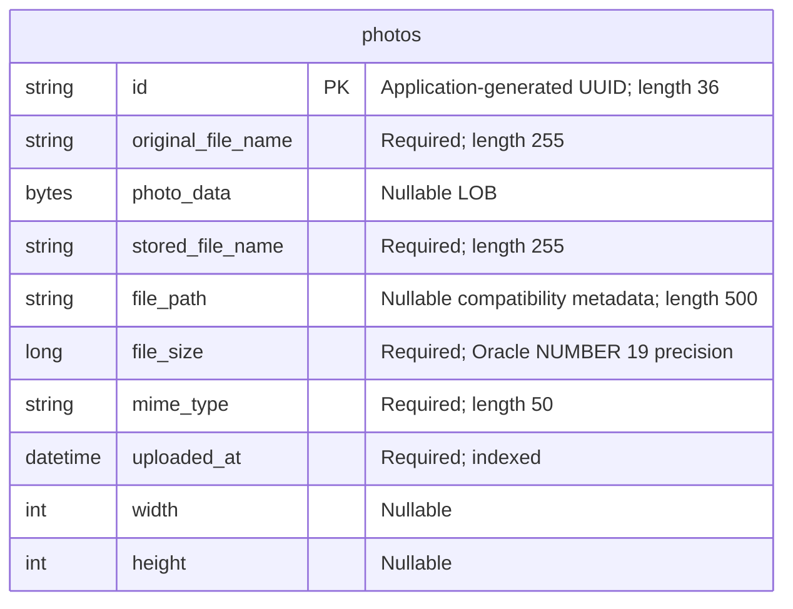

# Data Architecture & Persistence Layer

The data layer contains one JPA entity, `Photo`, persisted through Spring Data JPA/Hibernate to Oracle, with H2 configured for tests. Image bytes and metadata reside together in the `photos` table rather than in a separate file or object store.

## Database Configuration

| Service/Module | DB Type | Profile | Driver | Connection | Migration Tool |
|---|---|---|---|---|---|
| Photo Album | Oracle | Default | `com.oracle.database.jdbc:ojdbc8`; `oracle.jdbc.OracleDriver` | Environment-overridable Oracle Thin connection to the configured host, port and pluggable database; credentials supplied externally | No Flyway/Liquibase dependency or versioned migrations found; Hibernate recreates schema at startup |
| Photo Album | Oracle Free, as identified by the database image | `docker` | Same Oracle driver | Same environment-overridable Oracle Thin connection; selected by the supplied container configuration | Hibernate recreates schema at startup; Oracle initialization scripts manage schema-user privileges, not application-table migrations |
| Photo Album tests | H2 in memory | `test` | `com.h2database:h2` (test scope); `org.h2.Driver` | Process-local in-memory test database; separate from Oracle | Hibernate creates schema on startup and drops it on shutdown |

**Schema and initialization:** Both Oracle configurations use destructive schema creation, not incremental migration or schema validation; existing application tables/data can be replaced at application startup. `oracle-init/01-create-user.sql` grants object-creation privileges and configures the schema user's tablespace/quota; its comments delegate user creation to database-container initialization. `02-verify-user.sql` and `healthcheck.sql` perform verification only. No application seed data, `schema.sql`, `data.sql`, or `import.sql` was found in the application resources.

**Pooling and compatibility:** No explicit connection-pool sizing, timeout, or custom datasource bean was found. The JPA starter normally supplies HikariCP using framework defaults. Native queries and entity column definitions contain Oracle-specific constructs; H2 test configuration does not establish that Oracle query behavior is covered. The existing test activates `test` and checks context loading only.

Raw configuration properties and deployment details belong in `configuration-inventory.md`; connection and credential values are intentionally not reproduced here.

**Evidence:** `pom.xml:43-54,88-93`; `src/main/resources/application.properties:9-21`; `src/main/resources/application-docker.properties:1-17`; `src/test/resources/application-test.properties:1-10`; `src/test/java/com/photoalbum/PhotoAlbumApplicationTests.java:7-14`; `oracle-init/*.sql`; `docker-compose.yml:4,31-32`.

## Data Ownership per Service

| Service | Tables Owned | ORM Framework | Caching | Notes |
|---|---|---|---|---|
| Photo Album (`photo-album` Maven module) | `photos` (`Photo`) | Spring Data JPA with Hibernate, `javax.persistence` mappings | No explicit application cache or Hibernate second-level/query cache configured | Owns image BLOBs and metadata; no user, outbox, join, or migration-history entity found |

**Evidence:** `pom.xml:15-18,43-47`; `src/main/java/com/photoalbum/model/Photo.java:15-91`; `src/main/java/com/photoalbum/repository/PhotoRepository.java:15-16`.

## Entity Model

`Photo` is defined in `src/main/java/com/photoalbum/model/Photo.java:15-97`. Its Java types are `String` for identifiers/names/path/MIME type, `byte[]` for the LOB, `Long` for file size, `LocalDateTime` for the upload timestamp, and nullable `Integer` dimensions. The constructor assigns a UUID and local upload time; there is no database sequence or generated-ID annotation. The timestamp column also declares an Oracle current-timestamp default.

The non-unique `idx_photos_uploaded_at` index supports upload-time ordering. No foreign keys, entity associations, cascades, bidirectional links, optimistic-lock version column, or additional unique constraints are declared. The LOB has no explicit lazy-fetch annotation; listing queries also select its contents. `file_path` and `stored_file_name` are retained as compatibility metadata, not as the active image-storage location. `UploadResult` is an unpersisted result DTO, not a second entity.

**Transactions:** `PhotoServiceImpl` has class-level `@Transactional`; retrieval/navigation methods override it with read-only transactions. Writes use repository save/delete operations inside the service transaction boundary. There is no distributed transaction manager or custom isolation configuration in the inspected source.

**Evidence:** `src/main/java/com/photoalbum/service/impl/PhotoServiceImpl.java:28-30,53-75,112-115,160-174,195-237`; `src/main/java/com/photoalbum/model/UploadResult.java:1-10`.

## Key Repository Methods

All methods below belong to `PhotoRepository extends JpaRepository<Photo, String>` in `src/main/java/com/photoalbum/repository/PhotoRepository.java`. Standard inherited CRUD/paging operations are not enumerated; custom queries are all annotated native SQL, rather than derived finders or JPQL.

| Service | Repository | Notable Methods | Purpose |
|---|---|---|---|
| Photo Album | `PhotoRepository` | `List<Photo> findAllOrderByUploadedAtDesc()` | Returns all photos newest first, including image bytes; no limit |
| Photo Album | `PhotoRepository` | `List<Photo> findPhotosUploadedBefore(LocalDateTime uploadedAt)` | Strictly earlier timestamps, newest first; Oracle `ROWNUM` limits results to ten |
| Photo Album | `PhotoRepository` | `List<Photo> findPhotosUploadedAfter(LocalDateTime uploadedAt)` | Strictly later timestamps, oldest first; no result limit; Oracle `NVL` supplies fallback path metadata |
| Photo Album | `PhotoRepository` | `List<Photo> findPhotosByUploadMonth(String year, String month)` | Filters timestamp year/month with Oracle `TO_CHAR`; newest first |
| Photo Album | `PhotoRepository` | `List<Photo> findPhotosWithPagination(int startRow, int endRow)` | Inclusive one-based row range using nested Oracle `ROWNUM` queries |
| Photo Album | `PhotoRepository` | `List<Object[]> findPhotosWithStatistics()` | Returns photo columns plus file-size rank and upload-ordered running file-size total using analytic functions |

Query arguments use named parameter binding. No stored-procedure calls, cross-service batch finders, or bulk mutation queries were found. The service directly calls the listing and before/after queries; the month, pagination, and statistics methods are declared but not used by `PhotoServiceImpl`.

**Evidence:** repository lines `18-100`; `src/main/java/com/photoalbum/service/impl/PhotoServiceImpl.java:53-75,220-237`.

## Caching Strategy

| Layer | Observed behavior |
|---|---|
| Application/repository | No Spring Cache annotations, cache manager, Redis, Ehcache, Caffeine, or JCache provider dependency/configuration found in the application source and Maven build |
| Hibernate | Normal persistence-context/first-level entity identity applies within an entity manager; no explicit second-level cache, query cache, regions, TTL, or eviction policy configured |
| HTTP image delivery | Explicitly disables client/proxy storage with no-cache/no-store/private response directives and legacy cache-prevention headers |
| Session state | Security uses stateless requests; no distributed session cache configured |

There is no observed cache-aside, read-through, write-through, or write-behind implementation. Image delivery retrieves database BLOBs into byte arrays; gallery queries return whole entities including BLOB columns. The implementation explicitly prioritizes fresh image responses; no separate cache design rationale is documented.

**Evidence:** `pom.xml:30-101`; `src/main/java/com/photoalbum/controller/PhotoFileController.java:44-83`; `src/main/java/com/photoalbum/config/SecurityConfig.java:46-60`; `src/main/java/com/photoalbum/repository/PhotoRepository.java:22-100`.

## Data Ownership Boundaries

One application module owns one relational photo dataset. Runtime Oracle profiles address the configured application schema; the test profile instead uses an isolated in-memory H2 database. There is no evidence of independently owned service databases, cross-service database reads, gateway aggregation, or inter-service data replication.

Reads and writes use the same entity and repository; no separate CQRS read model, event store, or materialized read projection is implemented. Metadata and image payload share a row and transaction boundary. Image retrieval reads `photo_data` from the database, and deletion removes the entity containing the payload; compatibility path fields do not establish a second persistent store in the active service implementation.

Authentication identities are held by an in-memory user-details manager, not an application user table. There is no persisted photo-owner identifier or per-user data partition.

**Evidence:** `src/main/java/com/photoalbum/service/impl/PhotoServiceImpl.java:160-174,195-217`; `src/main/java/com/photoalbum/controller/PhotoFileController.java:44-69`; `src/main/java/com/photoalbum/config/SecurityConfig.java:33-43`; `src/main/java/com/photoalbum/model/Photo.java:19-91`.

### Data Classification & Sensitivity

| Entity | Sensitive Fields | Classification (PII/PHI/PCI/None) | Controls in Place |
|---|---|---|---|
| `Photo` | `photoData` may contain identifiable people, documents, or embedded image metadata; `originalFileName` may contain names or other identifiers | Potential PII, content-dependent; no dedicated PHI or PCI fields detected | Authentication protects configured upload/delete operations; gallery/image reads are public. No photo-owner authorization, field-level access controls, masking, image-metadata stripping, or application-level encryption found. No database encryption-at-rest configuration evidenced in inspected files; infrastructure controls cannot be confirmed |
| `Photo` | `id`, `storedFileName`, `filePath`, `fileSize`, `mimeType`, `uploadedAt`, `width`, `height` | None intrinsically; identifiers and timestamps can become linkable metadata | UUID identifiers reduce predictable numbering but do not authorize access. No field-level masking or encryption found |

HTTP cache prevention limits ordinary browser/proxy caching but is not access control or encryption at rest. The file-serving controller logs original filenames and a prefix of image bytes, and the upload service logs filenames; no log masking is apparent. Administrative credentials are supplied externally and BCrypt-encoded for the in-memory authentication manager; actual credential values are deliberately excluded from this document.

**Evidence:** `src/main/java/com/photoalbum/controller/PhotoFileController.java:53-66,74-83`; `src/main/java/com/photoalbum/service/impl/PhotoServiceImpl.java:179-182`; `src/main/java/com/photoalbum/config/SecurityConfig.java:28-60`.
