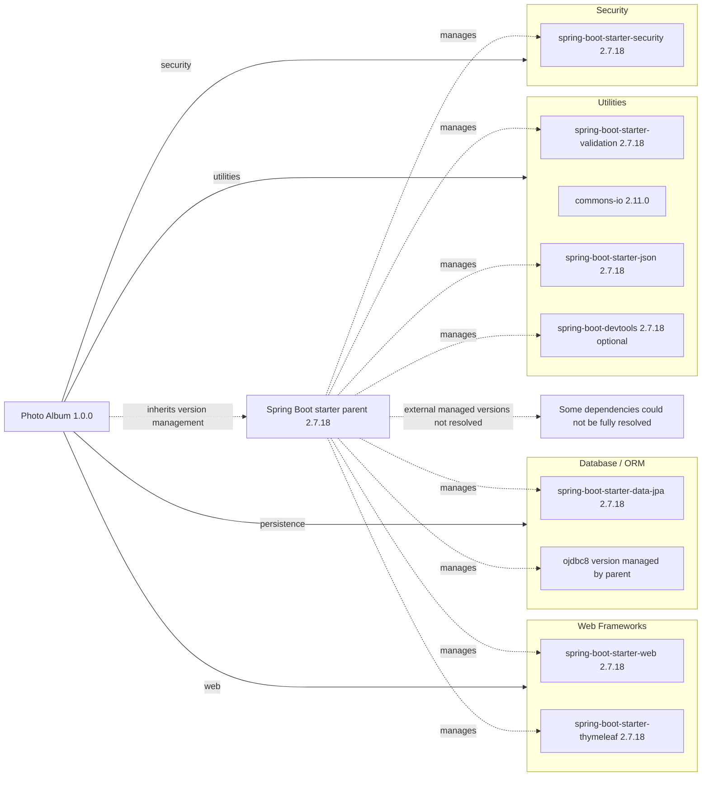

# Dependency Map

Photo Album (`com.photoalbum:photo-album:1.0.0`) declares 11 external dependencies in `pom.xml`: 9 non-test dependencies and 2 test dependencies. This map covers declared packages only; the Maven parent and build plugin are reported separately and are not included in that count.

## Dependencies

### Dependency Summary

| Category | Count | Key Libraries | Notes |
|----------|-------|---------------|-------|
| Web Frameworks | 2 | `org.springframework.boot:spring-boot-starter-web`, `org.springframework.boot:spring-boot-starter-thymeleaf` | Both inherit version 2.7.18; compile scope by default. |
| Database / ORM | 2 | `org.springframework.boot:spring-boot-starter-data-jpa`, `com.oracle.database.jdbc:ojdbc8` | JPA starter inherits 2.7.18, compile scope; Oracle driver has runtime scope and an externally managed version not resolved here. |
| Security | 1 | `org.springframework.boot:spring-boot-starter-security` | Inherits 2.7.18; compile scope by default. |
| Utilities | 4 | `org.springframework.boot:spring-boot-starter-validation`, `commons-io:commons-io`, `org.springframework.boot:spring-boot-starter-json`, `org.springframework.boot:spring-boot-devtools` | Boot packages inherit 2.7.18; Commons IO explicitly declares 2.11.0. All default to compile scope; DevTools is optional. |
| **Total non-test** | **9** | | Excludes the parent, build plugin, and test dependencies. |

Version evidence: `pom.xml:8-13` declares parent `org.springframework.boot:spring-boot-starter-parent:2.7.18`; `pom.xml:30-101` declares dependencies. Starter and DevTools versions follow the Boot release via inherited management, not explicit dependency-level versions. No local BOM import or dependency lockfile was found; the external parent/BOM contents and transitive dependency graph were not resolved. Consequently, no inferred transitive packages are counted or drawn as confirmed dependencies.

### Version & Compatibility Risks

Spring Boot 2.7.18 is the final 2.7 release and is outside community support. Moving to Boot 3 requires Java 17 or later and migration from Java EE `javax` APIs to Jakarta APIs; the POM currently targets Java 8. Commons IO 2.11.0 is an older pinned release that warrants an advisory review before modernization. Oracle JDBC and H2 compatibility must be assessed after resolving their inherited versions; this map is not a vulnerability scan.

### Notable Observations

- Spring Boot centralizes versions through its parent; no additional BOM imports are declared locally. `org.springframework.boot:spring-boot-maven-plugin` is also declared without an explicit version (`pom.xml:103-110`) and is a build plugin, not an application dependency.
- `spring-boot-starter-json` is declared explicitly alongside the web starter. Potential overlapping transitive functionality should be checked with a resolved Maven dependency tree; despite its POM comment, the JSON starter is not an image-processing library.
- DevTools is an optional compile dependency. Optionality limits propagation to consuming projects; it does not change its declared scope.
- No standalone logging, caching, messaging, or observability dependencies are declared. Their absence from this map does not prove that starters bring in none transitively.

## Test Dependencies

| Framework | Version | Notes |
|-----------|---------|-------|
| `org.springframework.boot:spring-boot-starter-test` | 2.7.18, inherited | Test scope; aggregate testing support. Individual framework and supporting-library versions are not declared locally. |
| `com.h2database:h2` | Managed by parent; unresolved | Test scope; in-memory database support. |

Total test-scope dependencies: 2

No separate Testcontainers, contract-testing library, or integration-test plugin is declared in the inspected POM. This build-file-only assessment does not establish whether integration tests exist or whether H2 behavior matches Oracle.
