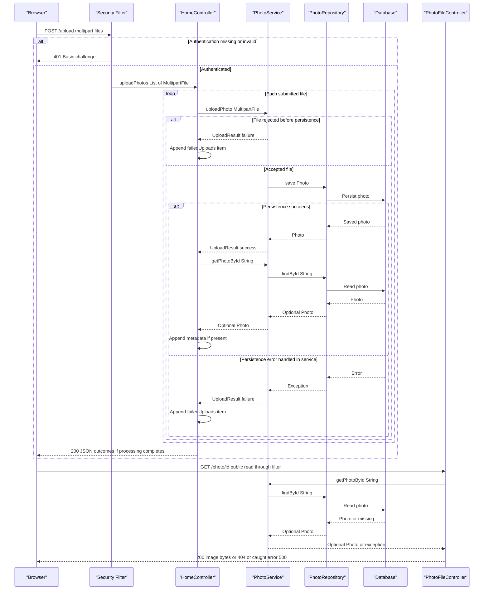

# API & Service Communication Contracts

The application defines five HTTP controller operations: two HTML reads, one binary photo read, one multipart upload with JSON results, and one form-based deletion. Browser requests, controller-to-service calls, and persistence calls are synchronous; no asynchronous service messaging was identified.

Static assessment of repository source and deployment definitions only; no tests, deployment, or live endpoint verification were performed. References below are repository-relative paths with line numbers. No credential values are reproduced.

## Service Catalog

| Service | Port | Category | Purpose |
|---|---|---|---|
| `photoalbum-java-app` / Maven `com.photoalbum:photo-album` | 8080, also published as host 8080 | API Layer / Business | Sole source-built application; serves gallery pages, uploads, image bytes, and deletion. |
| `oracle-db` | 1521, also published as host 1521 | Infrastructure | Third-party database container used by the Compose application; not a separate HTTP API. |
| Azure Kubernetes Service | Application exposure not defined in inspected script | Infrastructure | Provisioning script creates a cluster; not another source application. |
| Azure Container Registry | Application port not applicable | Infrastructure | Provisioning script creates an image registry and attaches it to the cluster. |
| Azure Database for PostgreSQL Flexible Server | 5432 in script-generated JDBC URL | Infrastructure | Provisioning-script target, not the database wired into the inspected runtime application configuration. |

Evidence: `pom.xml:15-21`, `docker-compose.yml:1-44`, `azure-setup.ps1:66-142,267`. The root POM defines one JAR and no Maven modules. Application dependencies include Spring Boot web, Thymeleaf, Data JPA, validation, security, JSON, Oracle JDBC, and Commons IO (`pom.xml:8-12,30-79`). The Oracle container uses `gvenzl/oracle-free:latest`; the application is built from the root Dockerfile (`docker-compose.yml:3-4,25-28`). No additional application deployments, Kubernetes manifests, Helm charts, or Bicep/Terraform definitions were identified in the inspected project files. Azure provisioning definitions do not establish that resources are deployed or that PostgreSQL is supported by the current application.

## API Endpoints Inventory

All paths are unversioned. No header/query version selector or application context-path override was identified.

| Service | Method | Path | Request Type | Response Type |
|---|---|---|---|---|
| `photoalbum-java-app` / `HomeController` | GET | `/` | No declared body, query, or path parameter | Normally 200 HTML, `index` view with `List<Photo>` and a timestamp in its model. Loading errors render an empty gallery instead of an explicit error status. |
| `photoalbum-java-app` / `HomeController` | POST | `/upload` | Multipart form-data; required repeated `files` part bound to `List<MultipartFile>`; authenticated | 200 JSON `Map<String,Object>` containing `success`, `uploadedPhotos`, `failedUploads`; per-file failures can still yield 200. Explicit 400 JSON for an empty/null list reaching the handler; missing required part normally produces framework 400. Unauthenticated requests are challenged with HTTP Basic, normally 401. |
| `photoalbum-java-app` / `DetailController` | GET | `/detail/{id}` | String path parameter `id` | Normally 200 HTML `detail` view, with `Photo` and previous/next identifiers. Missing photo or caught lookup/navigation errors redirect to `/` (normally 302), not 404. |
| `photoalbum-java-app` / `DetailController` | POST | `/detail/{id}/delete` | String path parameter `id`; form POST with no required body fields; authenticated | Redirect to `/` (normally 302) with success/error flash attribute for deletion, missing photo, or caught failure. Unauthenticated requests normally receive 401. |
| `photoalbum-java-app` / `PhotoFileController` | GET | `/photo/{id}` | String path parameter `id`; browser may append an unused `_t` cache-busting query | 200 `ResponseEntity<Resource>` with `ByteArrayResource` image bytes and stored MIME type; 404 for absent photo/empty bytes; empty 500 response for caught exceptions. |

Controller evidence: `src/main/java/com/photoalbum/controller/HomeController.java:37-98`, `src/main/java/com/photoalbum/controller/DetailController.java:18-78`, `src/main/java/com/photoalbum/controller/PhotoFileController.java:23-86`. Authentication evidence: `src/main/java/com/photoalbum/config/SecurityConfig.java:46-61`.

Contract details:

- Upload processing is sequential and is not an all-files atomic operation: each file calls the service independently. A successful upload is looked up again before inclusion in `uploadedPhotos`; if that lookup returns empty, no success or failure item is added for that file. That follow-up lookup is not caught by the controller, so an exception can escape rather than produce the documented per-file envelope (`HomeController.java:68-97`).
- Service-level rejection is represented in `failedUploads`, not necessarily an HTTP 400. Multipart parsing can reject requests before controller execution; no custom multipart exception response contract was found. Validation details belong in `business-workflows.md`.
- Image responses explicitly send `Cache-Control: no-cache, no-store, must-revalidate, private`, `Pragma: no-cache`, `Expires: 0`, and `X-Photo-ID`, `X-Photo-Name`, `X-Photo-Size` headers (`PhotoFileController.java:74-83`).
- Static CSS, JavaScript, and a bundled upload image are resources, not additional annotated controller operations. The returned `filePath` is a compatibility value, not the canonical retrieval endpoint; browser code constructs `/photo/{id}` (`src/main/java/com/photoalbum/service/impl/PhotoServiceImpl.java:112-115,160-168`; `src/main/resources/static/js/upload.js:176-179`).

## Management & Observability Endpoints

| Service | Endpoint | Custom Metrics (if any) |
|---|---|---|
| `photoalbum-java-app` | No explicitly defined health, Actuator, metrics, Prometheus, Swagger, or OpenAPI endpoint found | No custom metric registration or timing annotations found; controllers/services use logging. |
| `oracle-db` | No HTTP management endpoint defined in Compose | Container health check only; not a published application API or metric. |
| Azure provisioning resources | No application management/metrics endpoint defined in inspected provisioning script | No exporter or Application Insights integration identified. |

Evidence: application dependencies in `pom.xml:30-101` contain no Actuator, Springdoc, or metrics-export starter; inspected application Java sources define only the five routes listed above. Logging examples: `HomeController.java:26,44-45` and `PhotoServiceImpl.java:32,179-189`. Compose defines database health checking separately (`docker-compose.yml:17-22`). Framework-provided `/error` behavior, if active through Boot auto-configuration, is not a custom API or health endpoint; no stable custom error DTO is defined.

## DTOs & Contracts

| Type | Contract role | Mutability / exposure |
|---|---|---|
| `MultipartFile` / `List<MultipartFile>` | Framework multipart request binding for `/upload` | Not a dedicated application request DTO. |
| `UploadResult` | Internal service-to-controller outcome for each file | Mutable POJO with setters; not returned directly over HTTP. |
| `Photo` | Service-owned domain entity used in HTML models and as the source for selected upload-response metadata | Mutable POJO; not a gateway aggregation DTO and not directly returned as the complete JSON entity. |
| `Map<String,Object>` / lists of maps | Actual JSON upload response contract | Mutable, manually assembled, without a dedicated response class. |
| `Resource` / `ByteArrayResource` | Binary image HTTP response | Framework resource wrapper, not JSON. |

Evidence: `src/main/java/com/photoalbum/model/UploadResult.java:6-63`, `src/main/java/com/photoalbum/model/Photo.java:19,93-108,120-199`, `HomeController.java:57-95`, `PhotoFileController.java:69-83`.

There are no gateway-level DTOs. The upload envelope has a boolean overall outcome and separate lists for successful and failed items; the explicit empty-input 400 instead contains `success` and `error`. Failure items contain the submitted filename and an error message (`HomeController.java:58-65,85-95`). See `data-architecture.md` for entity fields and persistence details rather than treating entities as a published schema.

The JSON starter supplies Jackson-based default conversion; no application-defined `ObjectMapper`, custom serializer, JSON naming strategy, OpenAPI/Swagger specification, protobuf schema, or GraphQL schema was identified. A `LocalDateTime` is inserted into upload-response metadata and consumed with JavaScript `Date`; there is no explicit application-level timestamp format/time-zone contract (`pom.xml:75-79`; `HomeController.java:79`; `src/main/resources/static/js/upload.js:161-170`). HTML responses are template-rendered, and photo responses are raw bytes, not base64 JSON.

## Communication Patterns

- **Browser and server:** Same-origin HTTP form/navigation requests and `fetch('/upload')` with `FormData`. JavaScript's `async`/`await` is client-side request handling, not a message queue or asynchronous backend workflow (`src/main/resources/static/js/upload.js:90-132`; `src/main/resources/templates/detail.html:50,67,77-87`).
- **Internal calls:** Controllers invoke `PhotoService` directly; `PhotoServiceImpl` invokes `PhotoRepository` synchronously, with transactional service methods. Database communication uses JPA/JDBC, not another application's REST endpoint (`src/main/java/com/photoalbum/service/PhotoService.java:13-54`; `PhotoServiceImpl.java:28-30,54-75,172-177,198-237`; `src/main/java/com/photoalbum/repository/PhotoRepository.java:15-27`).
- **Aggregation:** No API gateway or multi-service response composition exists. Upload collects per-file outcomes locally, and the detail controller combines a photo with navigation identifiers from the same service (`HomeController.java:68-95`; `DetailController.java:38-54`). No gateway fallback is applicable.
- **Async/discovery/load balancing:** No broker clients, event publishing, gRPC, Feign, REST/WebClient clients, service registry, or application-side load balancer were identified in the source/build. Compose resolves the configured database hostname on its bridge network; this is not registry-based application discovery (`docker-compose.yml:31-34,49-51`).
- **Resilience and timeouts:** No explicit application retry policy, circuit breaker, bulkhead, fallback service, or request/query timeout value was found. Framework/driver defaults are not treated as verified timeout guarantees. Gallery errors fall back to empty HTML; detail errors redirect; binary serving errors return 500; upload service errors generally become failed results, while transaction completion and uncaught controller lookups may still propagate exceptions (`HomeController.java:38-49,68-97`; `DetailController.java:38-58`; `PhotoFileController.java:84-86`; `PhotoServiceImpl.java:150-192`). Container restart policy is not request retry.
- **API availability:** Compose starts the application after database health succeeds; startup also requires externally supplied authentication/database credentials. Full readiness and startup configuration belong in `configuration-inventory.md` (`docker-compose.yml:31-44`; `SecurityConfig.java:34-42`).
- **Security contract:** Stateless HTTP Basic authentication protects POST `/upload` and `/detail/*/delete`; all other requests are permitted. An in-memory user is assigned `ADMIN`, but the route rules require only authentication, not an explicit role check. CSRF is disabled; no JWT, OAuth2, method-level RBAC, or custom CORS policy was found (`SecurityConfig.java:34-61`). No application TLS connector, HTTPS enforcement, or TLS termination definition was identified in the inspected runtime configuration/Docker definitions; live ingress/transport security cannot be inferred. Clients should not assume Basic credentials are protected in transit.
- **Other external communication:** Gallery HTML loads Bootstrap from an HTTPS CDN, a browser asset dependency rather than a backend business-service call (`src/main/resources/templates/index.html:7`). Azure provisioning uses control-plane commands and an external IP lookup; these are provisioning-time operations, not request-flow services (`azure-setup.ps1:69-105,117-142,167`).

## Service Technology Matrix

Columns unused by every inspected service (discovery, gateway, application cache, and metrics export) are omitted.

| Service | Web | Data Access | Actuator / Health |
|---|---|---|---|
| `photoalbum-java-app` | Spring MVC; HTML templates, JSON, binary resource | Spring Data JPA / Oracle JDBC | No explicit application health endpoint or Actuator dependency |
| `oracle-db` | No application HTTP API | Database server; third-party container | Compose database health check |
| AKS provisioning target | Application ingress not defined | Not applicable | No application health contract defined in script |
| ACR provisioning target | Managed registry, not business HTTP API | Not applicable | Not defined in script |
| PostgreSQL provisioning target | No application HTTP API | Managed database; runtime application wiring not established | Not defined in script |

Evidence: `pom.xml:30-79`, `docker-compose.yml:3-22,25-44`, `azure-setup.ps1:66-142`. No application cache annotations or cache dependency were found; HTTP cache-control headers are not a server-side cache implementation. Persistence/cache details belong in `data-architecture.md`.

## Service Communication Sequence

The primary upload-and-display flow below shows local per-file result aggregation, not gateway composition. Solid arrows indicate synchronous requests/calls; dashed arrows indicate responses. There is no broker, background job, or circuit-breaker retry in this flow.

Evidence: `HomeController.java:55-97`, `SecurityConfig.java:46-61`, `PhotoServiceImpl.java:67-75,82-192`, `PhotoFileController.java:37-86`. The diagram's handled persistence-error branch describes exceptions caught within the service body; failures at transactional completion or the controller's subsequent lookup can still abort the JSON response.
