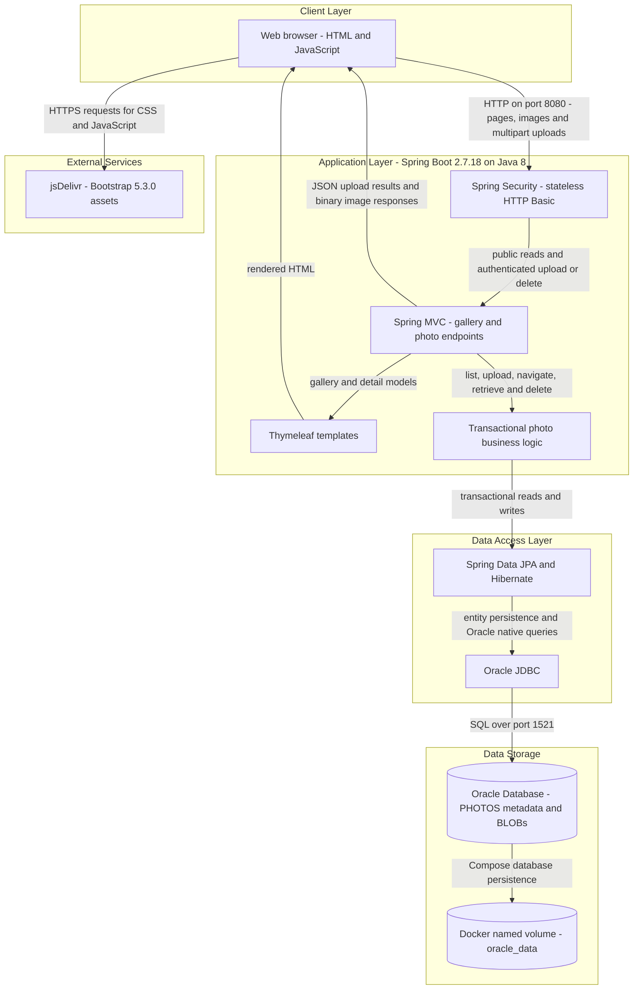
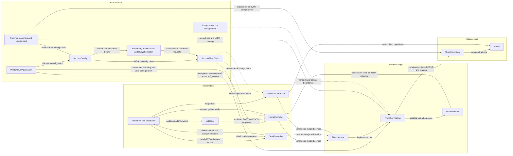

# Architecture Diagram

Photo Album is a single-module Java web application with server-rendered gallery pages, browser-side uploads, and Oracle-backed photo storage. This static assessment describes repository evidence, not a verified running deployment; credentials and secret values are omitted.

## Application Architecture

### Technology Stack Summary

| Layer | Technology | Version | Purpose |
|---|---|---|---|
| Runtime and packaging | Java, Maven, executable Spring Boot JAR | Java 8; Docker build Maven 3.9.6; application 1.0.0 | One deployable application; multi-stage container build. Evidence: `pom.xml:15-27`, `pom.xml:103-109`, `Dockerfile:1-31`. |
| Application framework | Spring Boot and Spring MVC | Spring Boot 2.7.18; framework versions inherited from its parent | HTTP controllers, multipart handling, dependency injection, and application bootstrap. Evidence: `pom.xml:8-12`, `pom.xml:30-35`, `src/main/java/com/photoalbum/PhotoAlbumApplication.java:9-13`. |
| Presentation | Thymeleaf, browser JavaScript, Bootstrap | Thymeleaf parent-managed; Bootstrap 5.3.0 | Server-rendered gallery and detail pages with asynchronous uploads. Evidence: `pom.xml:37-41`, `src/main/resources/templates/index.html:7`, `src/main/resources/templates/index.html:124-125`, `src/main/resources/static/js/upload.js:103`. |
| Request security | Spring Security, BCrypt | Parent-managed; no independent version declared | In-memory administrator, stateless HTTP Basic, authenticated upload and delete, public reads; CSRF explicitly disabled. Evidence: `pom.xml:62-66`, `src/main/java/com/photoalbum/config/SecurityConfig.java:28-61`. |
| Business logic | Spring services, transactions, Java ImageIO | Spring parent-managed; ImageIO supplied by Java 8 | Upload validation, header-based dimension inspection, navigation, retrieval, and deletion. Evidence: `src/main/java/com/photoalbum/service/impl/PhotoServiceImpl.java:28-48`, `src/main/java/com/photoalbum/service/impl/PhotoServiceImpl.java:81-179`, `src/main/java/com/photoalbum/service/impl/PhotoServiceImpl.java:198-237`. |
| Persistence | Spring Data JPA, Hibernate, Oracle `ojdbc8` | Parent-managed; no independent versions declared | Entity persistence plus Oracle-specific native queries. Evidence: `pom.xml:43-54`, `src/main/java/com/photoalbum/repository/PhotoRepository.java:15-100`. |
| Database | Oracle Database Free container | `gvenzl/oracle-free:latest`; exact database version unpinned | Stores both photo metadata and binary contents in `PHOTOS`. Evidence: `docker-compose.yml:3-14`, `src/main/java/com/photoalbum/model/Photo.java:15-41`. |
| Local deployment | Docker and Docker Compose | Tool versions unspecified; runtime image `eclipse-temurin:8-jre` | Separate app and Oracle containers on a bridge network; publishes 8080 and 1521. Evidence: `Dockerfile:17-31`, `docker-compose.yml:10-14`, `docker-compose.yml:24-51`. |
| Test-only persistence | H2 | Parent-managed; test scope | In-memory test database, not an additional production datastore. Evidence: `pom.xml:88-93`, `src/test/resources/application-test.properties:2-9`. |

### Data Storage & External Services

Oracle is the application's runtime datastore: the `Photo` entity maps to `photos`, including a `photo_data` LOB, filenames, MIME type, size, timestamp, and dimensions (`src/main/java/com/photoalbum/model/Photo.java:15-90`). Uploads read bytes into the database and image responses return those bytes through `/photo/{id}`; compatibility `/uploads/` paths are not the active upload-storage mechanism (`src/main/java/com/photoalbum/service/impl/PhotoServiceImpl.java:112-174`, `src/main/java/com/photoalbum/controller/PhotoFileController.java:23-69`). Compose persists Oracle files in `oracle_data`, mounts database initialization scripts, and waits for database health before starting the application (`docker-compose.yml:12-22`, `docker-compose.yml:39-47`).

The browser fetches Bootstrap assets from jsDelivr (`src/main/resources/templates/index.html:7`, `src/main/resources/templates/index.html:124`). No cache, message broker, outbound business API client, or object-storage integration was identified in the inspected application sources and runtime configurations. H2 is confined to tests. Database and administrator credentials are supplied through external configuration; values are not reproduced here (`docker-compose.yml:30-36`, `src/main/java/com/photoalbum/config/SecurityConfig.java:34-42`).

### Key Architectural Decisions

- **Layered monolith with constructor injection:** MVC controllers depend on the `PhotoService` interface; its implementation depends on `PhotoRepository`. The application is packaged as one JAR rather than independently deployed business services (`pom.xml:15-18`, `src/main/java/com/photoalbum/controller/HomeController.java:24-32`, `src/main/java/com/photoalbum/service/impl/PhotoServiceImpl.java:28-48`).
- **Database-centric binary storage with Oracle coupling:** photo metadata and bytes share one entity, and native repository queries use `ROWNUM`, `NVL`, and `TO_CHAR`. Both runtime property files set Hibernate schema management to `create`, so schema recreation at startup is configured even though Compose retains database files (`src/main/java/com/photoalbum/model/Photo.java:15-41`, `src/main/java/com/photoalbum/repository/PhotoRepository.java:34-87`, `src/main/resources/application.properties:17-21`, `src/main/resources/application-docker.properties:13-17`).
- **Synchronous secured mutations:** upload and deletion execute within the HTTP request through transactional service methods. Security requires authentication for those POST routes, allows other requests, uses stateless HTTP Basic, and disables CSRF; the configured administrator is held in memory with a BCrypt-encoded password (`src/main/java/com/photoalbum/config/SecurityConfig.java:28-61`, `src/main/java/com/photoalbum/service/impl/PhotoServiceImpl.java:28-30`, `src/main/java/com/photoalbum/service/impl/PhotoServiceImpl.java:54-55`).

## Component Relationships

### Component Inventory

| Component | Layer | Type | Responsibility |
|---|---|---|---|
| `index.html`, `detail.html`; shared `layout.html` template | Presentation | Thymeleaf templates | Gallery, metadata, previous/next navigation, image URLs, and delete form. `layout.html` also defines a reusable page shell; actual controller returns are `index` and `detail`. Evidence: `src/main/resources/templates/index.html:94-125`, `src/main/resources/templates/detail.html:50-87`, `src/main/resources/templates/layout.html:1-49`, `src/main/java/com/photoalbum/controller/HomeController.java:49`, `src/main/java/com/photoalbum/controller/DetailController.java:54`. |
| `upload.js` | Presentation | Browser script | Sends multipart uploads, consumes JSON, and builds gallery links to the photo and detail endpoints. Evidence: `src/main/resources/static/js/upload.js:103`, `src/main/resources/static/js/upload.js:178-179`. |
| `HomeController` | Presentation | MVC controller | Serves `GET /`; handles `POST /upload`, delegates per-file uploads, and translates results into response maps. Constructor-injected `PhotoService`. Evidence: `src/main/java/com/photoalbum/controller/HomeController.java:24-99`. |
| `DetailController` | Presentation | MVC controller | Serves `GET /detail/{id}`, retrieves adjacent photos, and handles `POST /detail/{id}/delete` with redirect feedback. Constructor-injected `PhotoService`. Evidence: `src/main/java/com/photoalbum/controller/DetailController.java:17-79`. |
| `PhotoFileController` | Presentation | Binary HTTP controller | Serves `GET /photo/{id}` from entity bytes with MIME type and no-cache headers. Constructor-injected `PhotoService`. Evidence: `src/main/java/com/photoalbum/controller/PhotoFileController.java:22-89`. |
| `PhotoService` | Business logic | Service interface | Defines gallery listing, lookup, upload, deletion, and previous/next navigation. Evidence: `src/main/java/com/photoalbum/service/PhotoService.java:13-55`. |
| `PhotoServiceImpl` | Business logic | Transactional Spring service | Implements the service interface; constructor-injects the repository and upload settings, validates MIME and size, inspects image dimensions with a 40-million-pixel limit, saves BLOBs, and performs retrieval/deletion/navigation. Evidence: `src/main/java/com/photoalbum/service/impl/PhotoServiceImpl.java:28-48`, `src/main/java/com/photoalbum/service/impl/PhotoServiceImpl.java:81-179`, `src/main/java/com/photoalbum/service/impl/PhotoServiceImpl.java:198-237`. |
| `UploadResult` | Business logic | Result DTO | Carries upload success, original filename, error message, and photo ID between service and controller; controller constructs JSON response maps. Evidence: `src/main/java/com/photoalbum/model/UploadResult.java:6-10`, `src/main/java/com/photoalbum/controller/HomeController.java:69-99`. |
| `PhotoRepository` | Data access | Spring Data repository | Extends `JpaRepository<Photo, String>`; native queries support ordered listing and navigation. Additional month, pagination, and statistics queries exist but are not called by the inspected service. Evidence: `src/main/java/com/photoalbum/repository/PhotoRepository.java:15-100`, `src/main/java/com/photoalbum/service/impl/PhotoServiceImpl.java:54-74`, `src/main/java/com/photoalbum/service/impl/PhotoServiceImpl.java:224-237`. |
| `Photo` | Data access | JPA entity | UUID identity, binary photo data, file metadata, upload timestamp, dimensions, and upload-time index; no inter-entity associations identified. Evidence: `src/main/java/com/photoalbum/model/Photo.java:15-108`. |
| `PhotoAlbumApplication` | Infrastructure | Spring Boot entry point | Starts the application and enables conventional component scanning and auto-configuration. Evidence: `src/main/java/com/photoalbum/PhotoAlbumApplication.java:9-13`. |
| `SecurityConfig`, `SecurityFilterChain` | Infrastructure | Configuration and request filter chain | Defines route authorization and stateless HTTP Basic; explicitly disables CSRF. Evidence: `src/main/java/com/photoalbum/config/SecurityConfig.java:25-61`. |
| In-memory administrator, BCrypt encoder | Infrastructure | Authentication beans | Configured administrator credentials are encoded and registered in memory, separate from photo persistence. Evidence: `src/main/java/com/photoalbum/config/SecurityConfig.java:28-42`. |
| Runtime properties and environment | Infrastructure | Externalized configuration | Configure port 8080, Oracle connection, Hibernate schema behavior, multipart limits, and service validation; Docker profile receives Compose environment overrides. Evidence: `src/main/resources/application.properties:1-34`, `src/main/resources/application-docker.properties:1-35`, `docker-compose.yml:30-36`. |
| Spring transaction management | Infrastructure | Cross-cutting service proxy | Class-level transactional writes and explicitly read-only query/navigation methods. Evidence: `src/main/java/com/photoalbum/service/impl/PhotoServiceImpl.java:28-30`, `src/main/java/com/photoalbum/service/impl/PhotoServiceImpl.java:54-55`, `src/main/java/com/photoalbum/service/impl/PhotoServiceImpl.java:224-235`. |
| `MathUtil` | Utility | Standalone helper | Defines integer GCD; no participation in the traced photo request flow was identified, so omitted from the relationship diagram. Evidence: `src/main/java/com/photoalbum/util/MathUtil.java:6-21`. |

Relationships describe direct synchronous calls, MVC rendering, HTTP interactions, and configured framework concerns. No application-defined listeners, event bus, asynchronous workers, gRPC endpoints, or separate business services were identified in the inspected source tree. Framework-managed versions above are declarations/inheritance observations, not resolved dependency or runtime measurements.
