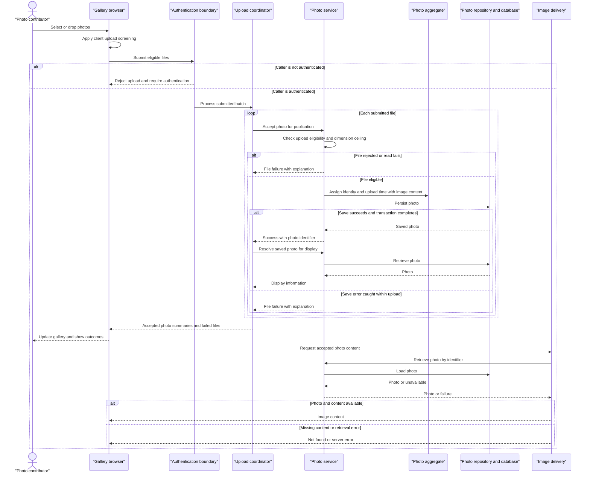

# Core Business Workflows

Photo Album lets visitors browse a shared collection of uploaded images and navigate between individual photos. Authenticated users can add multiple photos and permanently remove photos from the collection.

Assessment is based on static inspection of `src/main`; runtime behavior was not tested. Source references below use repository-relative paths and line numbers. No credential values are reproduced.

## Domain Entities

| Entity | Service / Bounded Context | Description | Key Relationships |
|---|---|---|---|
| Photo | PhotoService / Photo collection management | An uploaded image together with the descriptive information needed to display, navigate, and manage it. The only persisted business entity found; a standalone aggregate boundary is inferred, not an explicit DDD implementation. | Contains the image content and its display metadata. Older and newer photos are computed navigation neighbors, not stored relationships. No album, owner, or user association is modeled. |
| UploadResult | PhotoService / Upload processing | Transient per-file outcome, not a persisted entity: communicates acceptance or rejection to the batch-upload coordinator. | A successful outcome references a Photo; a failed outcome carries the submitted filename and explanation. |

Evidence: `src/main/java/com/photoalbum/model/Photo.java:12-19,28-108`; `src/main/java/com/photoalbum/model/UploadResult.java:3-29`; `src/main/java/com/photoalbum/service/impl/PhotoServiceImpl.java:220-237`.

## Service-to-Domain Mapping

This is one application with one business service, not independently deployed domain services. The following are in-process responsibilities within the same photo-management context.

| Service | Domain Context | Owned Entities | External Dependencies |
|---|---|---|---|
| PhotoService / PhotoServiceImpl | Upload, retrieve, navigate, and delete collection items | Photo; produces UploadResult | PhotoRepository and the photo database; image-header reader for optional dimensions |
| HomeController | Gallery presentation and batch-upload coordination | None; composes Photo summaries and UploadResult outcomes | PhotoService; browser upload interface |
| DetailController | Individual-photo viewing and removal | None; composes Photo and neighboring-photo identifiers | PhotoService |
| PhotoFileController | Delivery of stored image content | None; reads Photo content | PhotoService |

PhotoService is the business-operation boundary; the photo database is the durable source of truth for both metadata and image content. Controllers do not maintain independent copies. Evidence: `src/main/java/com/photoalbum/service/impl/PhotoServiceImpl.java:25-47,160-185,195-237`; `src/main/java/com/photoalbum/controller/HomeController.java:28-31,68-95`; `src/main/java/com/photoalbum/controller/DetailController.java:23-27,38-54`; `src/main/java/com/photoalbum/controller/PhotoFileController.java:28-31,44-83`.

## Primary Workflows

### Workflow 1: Upload multiple photos and publish them in the gallery

1. A user selects or drops files into the gallery. The browser applies **Client upload screening**, then submits eligible files together to `POST /upload`. The authentication boundary requires an authenticated caller; the UI itself does not implement a login workflow.
2. HomeController applies **Batch presence**, then iterates files sequentially. Each file is passed to PhotoService independently; there is no batch-level transaction.
3. PhotoService applies **Server upload eligibility** and **Image dimension ceiling**. It reads the bytes, attempts optional dimension extraction, and creates a Photo using **Photo identity and timestamp generation**.
4. The service saves the image content and metadata together, returning an UploadResult. Rejected files and caught read/save errors produce failure outcomes rather than intentionally undoing other files.
5. For each reported success, HomeController looks the saved Photo up again and builds a display summary. It aggregates summaries and failures under **Partial batch success**.
6. The browser shows successful and failed counts/messages, prepends accepted photos to the gallery, and requests their image content by identifier. Failed HTTP responses or network errors result in generic upload feedback; no automatic retry is implemented.

Evidence: `src/main/resources/static/js/upload.js:48-131,135-179`; `src/main/java/com/photoalbum/config/SecurityConfig.java:45-61`; `src/main/java/com/photoalbum/controller/HomeController.java:55-97`; `src/main/java/com/photoalbum/service/impl/PhotoServiceImpl.java:81-193`.

**Outcome caveat:** the post-save lookup is outside the service upload error-handling block. A missing record is silently omitted from both result lists; a lookup exception can interrupt the request after earlier files have been saved. A successful batch response is therefore not guaranteed after every per-file save.

Evidence: `src/main/java/com/photoalbum/controller/HomeController.java:68-95`; `src/main/java/com/photoalbum/service/impl/PhotoServiceImpl.java:67-75`.

### Workflow 2: Browse the collection and navigate individual photos

1. A visitor opens `GET /`. HomeController retrieves the collection through PhotoService and PhotoRepository using **Gallery chronological ordering**, then renders image cards.
2. The browser obtains each card's actual image from `GET /photo/{id}`. PhotoFileController retrieves the Photo, checks that content exists, and returns it with the stored media type. Image responses discourage reuse of stale content.
3. Opening `GET /detail/{id}` retrieves the selected Photo, then separately retrieves its older and newer neighbors under **Temporal navigation**. The detail page combines metadata, image, and available navigation links.
4. **Read degradation** determines the user experience on failure: gallery-load errors render an empty collection; invalid, missing, or failed detail loads redirect to the gallery; unavailable individual image content returns a not-found or server-error response rather than a replacement image.

Evidence: `src/main/java/com/photoalbum/controller/HomeController.java:37-49`; `src/main/java/com/photoalbum/repository/PhotoRepository.java:18-56`; `src/main/java/com/photoalbum/service/impl/PhotoServiceImpl.java:50-75,220-237`; `src/main/java/com/photoalbum/controller/DetailController.java:32-58`; `src/main/java/com/photoalbum/controller/PhotoFileController.java:37-86`; `src/main/resources/templates/index.html:81-109`; `src/main/resources/templates/detail.html:62-94`.

### Workflow 3: Confirm deletion and remove a photo

1. The detail page asks for browser confirmation before submitting `POST /detail/{id}/delete`. This is a presentation safeguard, not server-side approval.
2. After authentication, DetailController calls PhotoService. Under **Delete existence**, the service looks up the Photo and either returns not-found or deletes the record containing its metadata and image content.
3. The controller adds success, not-found, or generic failure feedback and redirects to the gallery, which displays flash messages. There is no soft-delete, restore, or compensating business action in the traced implementation.

Evidence: `src/main/resources/templates/detail.html:50-59`; `src/main/java/com/photoalbum/config/SecurityConfig.java:54-60`; `src/main/java/com/photoalbum/service/impl/PhotoServiceImpl.java:195-217`; `src/main/java/com/photoalbum/controller/DetailController.java:64-78`; `src/main/resources/templates/index.html:37-46`.

No scheduled, event-listener, message-handler, or startup business-state initialization entry points were found in `src/main/java`; the application entry point only starts the application. Repository month filtering, pagination, and statistics methods are not exposed by the inspected business service/controllers and are not treated as active user workflows. Evidence: `src/main/java/com/photoalbum/PhotoAlbumApplication.java:9-14`; `src/main/java/com/photoalbum/repository/PhotoRepository.java:58-100`; `src/main/java/com/photoalbum/service/impl/PhotoServiceImpl.java:50-237`.

## Cross-Service Data Flows

There are no backend-to-backend domain-service calls, gateway aggregations, events, or circuit breakers in the inspected application. Composition is synchronous and local:

- **Upload composition:** browser → HomeController → PhotoService → photo database; after saving, HomeController rereads each successful Photo by its returned identifier and combines display summaries with rejection details. Binary content is not included in that summary; the browser subsequently retrieves it using the same Photo identifier.
- **Detail composition:** DetailController retrieves the selected Photo, then resolves older and newer photos by upload timestamp and exposes only their identifiers as navigation links. The browser fetches image content separately. There is no cross-context join.
- **Storage boundary:** image bytes are stored with the Photo. The generated `/uploads/` path is compatibility metadata, not a second file-store source of truth or a storage fallback.
- **Degradation:** upload supports mixed acceptance/rejection; gallery failures look like an empty collection; detail failures redirect home; image failures return 404 or 500. There is no alternate provider or cached business-data fallback.

Evidence: `src/main/java/com/photoalbum/controller/HomeController.java:37-48,68-97`; `src/main/java/com/photoalbum/controller/DetailController.java:38-57`; `src/main/java/com/photoalbum/controller/PhotoFileController.java:44-86`; `src/main/java/com/photoalbum/service/impl/PhotoServiceImpl.java:112-177,220-237`; `src/main/resources/static/js/upload.js:110-121,176-185`.

## Business Workflow Sequence

The primary upload-and-view workflow below shows actual rejection/degradation branches, not a hypothetical circuit breaker. The authenticated branch assumes the batch-presence rule passes.

Evidence: upload, authentication, and image-delivery sources cited in Workflows 1 and 2. Transaction-completion and post-save-lookup exceptions can escape the illustrated per-file failure handling, as described below.

## Business Rules & Decision Logic

### Validation and business decisions

| Rule | Implemented behavior | Evidence |
|---|---|---|
| Client upload screening | Browser accepts JPEG, PNG, GIF, and WebP declarations and files no larger than 10 MiB; only eligible files are submitted. This is advisory, not the authority for server acceptance. | `src/main/resources/static/js/upload.js:60-87` |
| Batch presence | A null or empty bound file list produces a bad-request result. No explicit file-count enforcement is present in the controller/service despite a configured maximum of 10 files. | `src/main/java/com/photoalbum/controller/HomeController.java:57-69`; `src/main/resources/application.properties:28-30` |
| Server upload eligibility | Submitted content type, lowercased, must be in the configured allowlist; size must be positive and no greater than the configured maximum. Defaults allow the four formats above and 10 MiB per file; multipart limits additionally cap each file at 10 MB and the request at 50 MB. A missing content type falls into generic upload error handling, not a dedicated validation outcome. | `src/main/java/com/photoalbum/service/impl/PhotoServiceImpl.java:41-47,86-110,186-189`; `src/main/resources/application.properties:24-30` |
| Image dimension ceiling | Where an image reader is available, header-derived width × height must not exceed 40,000,000 pixels. No-reader cases continue without dimensions; IOExceptions reject the file, while other dimension-extraction exceptions log a warning and continue. Successful decoding or correspondence between declared MIME type and actual bytes is not required by this path. | `src/main/java/com/photoalbum/service/impl/PhotoServiceImpl.java:34-35,117-158` |
| Photo metadata constraints | Declared entity validation requires nonblank original/stored filenames up to 255 characters, nonblank MIME type up to 50 characters, a file path up to 500 characters, positive nonnull size, and a nonnull upload time. These are entity constraints, not a separate controller validation stage. Image content itself has no nonempty entity-validation annotation; content delivery checks it separately. | `src/main/java/com/photoalbum/model/Photo.java:28-79`; `src/main/java/com/photoalbum/controller/PhotoFileController.java:57-62` |
| Photo identity and timestamp generation | Each constructed Photo receives a new identity and current local upload time. A separate generated filename preserves the submitted extension as compatibility metadata. There is no content-deduplication or original-filename uniqueness check in this upload path. | `src/main/java/com/photoalbum/model/Photo.java:93-108`; `src/main/java/com/photoalbum/service/impl/PhotoServiceImpl.java:112-115,160-177,243-248` |
| Partial batch success | Each file is processed separately. Overall success is true only when at least one saved Photo is successfully reread and added to the response. A processed batch returns HTTP 200 even if all files are rejected; an absent post-save record contributes neither a success summary nor a failure item. | `src/main/java/com/photoalbum/controller/HomeController.java:68-97` |
| Gallery chronological ordering | Persisted gallery results are newest first. Newly uploaded cards are prepended; displayed size is derived from bytes and dimensions are shown only when available. | `src/main/java/com/photoalbum/repository/PhotoRepository.java:18-27`; `src/main/resources/static/js/upload.js:154-158,172-196`; `src/main/resources/templates/index.html:104-107` |
| Temporal navigation | Previous selects the first strictly older photo ordered newest first; next selects the first strictly newer photo ordered oldest first. Equal timestamps do not become neighbors, empty neighbor results hide the relevant link, and navigation does not wrap around. | `src/main/java/com/photoalbum/repository/PhotoRepository.java:29-56`; `src/main/java/com/photoalbum/service/impl/PhotoServiceImpl.java:220-237`; `src/main/resources/templates/detail.html:74-94` |
| Delete existence | A missing Photo returns false; an existing Photo is deleted. There is no lifecycle status column or soft-delete business transition in the model/service. | `src/main/java/com/photoalbum/service/impl/PhotoServiceImpl.java:195-217`; `src/main/java/com/photoalbum/model/Photo.java:19-108` |
| Read degradation | Collection-read failure renders an empty gallery; missing/invalid/failed detail retrieval redirects home. Image requests with invalid identifiers, missing photos, or absent bytes return 404; caught delivery errors return 500. | `src/main/java/com/photoalbum/controller/HomeController.java:37-49`; `src/main/java/com/photoalbum/controller/DetailController.java:32-58`; `src/main/java/com/photoalbum/controller/PhotoFileController.java:37-86` |

### Lifecycle, integrity, and cross-cutting concerns

- **Lifecycle:** submitted file → rejected outcome or persisted Photo → physically deleted record. There are no explicit approval, moderation, draft, recovery, or album-membership states. Metadata and image content are saved as one Photo; no bidirectional entity relationships require maintenance. Evidence: `src/main/java/com/photoalbum/service/impl/PhotoServiceImpl.java:81-193,195-217`; `src/main/java/com/photoalbum/model/Photo.java:19-108`.
- **Transactions:** PhotoServiceImpl has class-level transaction scope; retrieval and navigation methods are marked read-only. Each controller-to-service upload call has its own transaction boundary, not one transaction for the whole batch. Caught save errors do not guarantee a normal per-file outcome: transaction completion occurs outside the method body and can still fail. Detail composition spans separate service calls, not one controller-wide snapshot. No saga or compensation flow was found. Evidence: `src/main/java/com/photoalbum/service/impl/PhotoServiceImpl.java:28-30,53-75,173-193,223-237`; `src/main/java/com/photoalbum/controller/HomeController.java:68-91`; `src/main/java/com/photoalbum/controller/DetailController.java:38-52`.
- **Error handling:** upload uses UploadResult for expected rejections and caught processing failures; retrieval/deletion failures are wrapped in generic runtime exceptions. Controllers translate failures as described above; upload's post-save lookup has no equivalent catch. No domain-specific exception hierarchy, dead-letter path, or automatic retry appears in these flows. Evidence: `src/main/java/com/photoalbum/model/UploadResult.java:3-29`; `src/main/java/com/photoalbum/service/impl/PhotoServiceImpl.java:55-75,150-189,214-217`; controller references above.
- **Audit/logging:** upload rejection/success, deletion, retrieval errors, and image serving are logged. Image delivery also logs original filenames and a prefix of image bytes. These operational logs are not an attributable business audit trail: the Photo model does not record an authenticated uploader or deleter. Evidence: `src/main/java/com/photoalbum/service/impl/PhotoServiceImpl.java:91-102,179-189,203-216`; `src/main/java/com/photoalbum/controller/PhotoFileController.java:45-72`; `src/main/java/com/photoalbum/model/Photo.java:19-108`.
- **Authorization:** gallery, detail, and image reads are public. Upload and delete require authentication through stateless HTTP Basic. One configured in-memory account is assigned ADMIN, but endpoint rules check authentication rather than the ADMIN role; no resource-ownership checks are modeled. Credentials are externally supplied and intentionally omitted here. The upload/delete controls remain visible in public templates; visibility does not grant permission. Evidence: `src/main/java/com/photoalbum/config/SecurityConfig.java:34-61`; `src/main/resources/templates/index.html:48-77`; `src/main/resources/templates/detail.html:50-59`; `src/main/java/com/photoalbum/model/Photo.java:19-108`.
