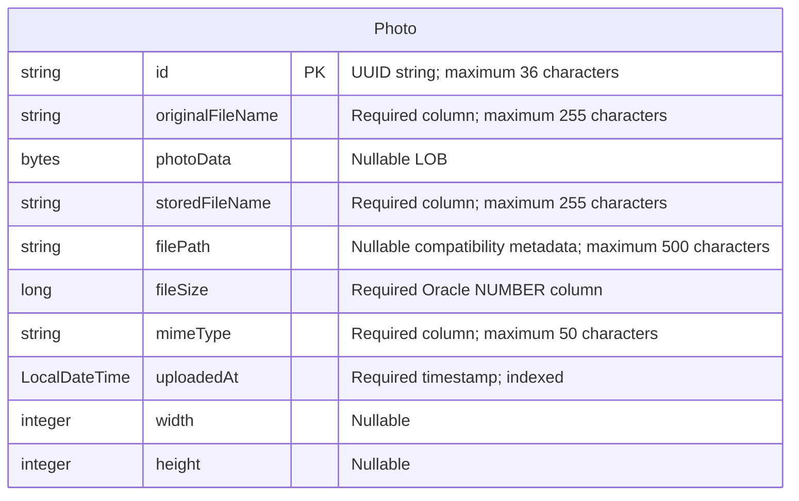

# Data Architecture & Persistence Layer

The data layer contains one JPA entity, `Photo`, persisted through Spring Data JPA/Hibernate to Oracle, with H2 configured for the test profile. Photo bytes and metadata share the same relational table; there is no separate persisted album or user entity.

Evidence references below use repository-relative paths and source line numbers. This is a static source assessment, not verification of a running database; credential values are intentionally omitted.

## Database Configuration

| Service/Module | DB Type | Profile | Driver | Connection | Migration Tool |
|---|---|---|---|---|---|
| `photo-album` | Oracle | Default/base configuration | `com.oracle.database.jdbc:ojdbc8`, runtime scope; Oracle JDBC driver | Environment-overridable Oracle Thin JDBC connection to a named database service; credentials externalized. No explicit pool sizing, timeout, or pool implementation settings found. | No Flyway/Liquibase dependency or versioned migration configuration found; Hibernate recreates schema at startup. |
| `photo-album` | Oracle | `docker` | Same runtime Oracle driver | Profile repeats the environment-overridable Oracle connection configuration; credentials externalized. | Hibernate recreates schema at startup, as in base configuration. |
| `photo-album` tests | H2, in memory | `test` | `com.h2database:h2`, test scope; H2 JDBC driver | Named in-memory database with test credentials omitted here; H2 dialect. | Hibernate creates schema for the context and drops it on shutdown. |

**Evidence:** `pom.xml:43-54,88-93`; `src/main/resources/application.properties:9-21`; `src/main/resources/application-docker.properties:1-17`; `src/test/resources/application-test.properties:1-10`. The test class explicitly activates the test profile (`src/test/java/com/photoalbum/PhotoAlbumApplicationTests.java:7-8`). No separate production profile was found in the application resources.

**Schema and initialization:** Entity annotations define the `photos` table and its timestamp index. Oracle bootstrap files provision/check the schema account and permissions rather than define application tables or insert sample photos (`oracle-init/01-create-user.sql:1-30`; `oracle-init/02-verify-user.sql:1-12`; `oracle-init/create-user.sh:21-41`). No application schema SQL, seed SQL, versioned migration directory, or programmatic data seeder was found in the reviewed source/resources. Startup schema recreation is destructive behavior, not an incremental schema migration strategy.

**Pooling:** HikariCP is expected through the standard Data JPA starter dependency chain, but is not explicitly selected/configured in repository source; effective runtime pool defaults were not inspected (`pom.xml:43-47`). Oracle-specific mappings and native queries mean the H2 profile alone does not establish Oracle query compatibility.

See `configuration-inventory.md` for the property inventory; this document describes persistence behavior rather than reproducing raw settings or connection/credential values.

## Data Ownership per Service

| Service | Tables Owned | ORM Framework | Caching | Notes |
|---|---|---|---|---|
| `photo-album` / `PhotoServiceImpl` | `photos` (`Photo`) | JPA (`javax.persistence`) with Hibernate via Spring Data JPA | No explicit application cache or Hibernate second-level/query-cache configuration found | Binary photo content and metadata are stored together; UUID identifiers are assigned in Java. No outbox or persisted account table found. |

**Evidence:** `pom.xml:15-18,43-47`; `src/main/java/com/photoalbum/model/Photo.java:15-97`; `src/main/java/com/photoalbum/service/impl/PhotoServiceImpl.java:28-37,160-174`; `src/main/java/com/photoalbum/config/SecurityConfig.java:33-42`.

## Entity Model

Only one entity exists, so there are no foreign keys, cardinality edges, join tables, bidirectional associations, association fetch settings, or cascade rules to draw.

| Java field | Java type | Persistence mapping |
|---|---|---|
| `id` | `String` | Primary key, length 36; generated by the constructor using a UUID, not a database sequence. |
| `originalFileName` | `String` | Non-null `original_file_name`, length 255. |
| `photoData` | `byte[]` | Nullable `photo_data` LOB; no explicit lazy-fetch annotation. |
| `storedFileName` | `String` | Non-null `stored_file_name`, length 255; no unique-column annotation. |
| `filePath` | `String` | Nullable `file_path`, length 500; compatibility metadata rather than authoritative filesystem storage. |
| `fileSize` | `Long` | Non-null `file_size`, Oracle numeric precision 19 and scale 0. |
| `mimeType` | `String` | Non-null `mime_type`, length 50. |
| `uploadedAt` | `LocalDateTime` | Non-null `uploaded_at`, Oracle timestamp with database current-timestamp default; constructor also assigns application-local current time. Non-unique index `idx_photos_uploaded_at`. |
| `width`, `height` | `Integer` | Nullable dimension columns. |

**Entity source:** `src/main/java/com/photoalbum/model/Photo.java:15-108`. Column constraints above are persistence facts; business validation rules are outside this assessment.

`UploadResult` is an unannotated response object, not another persistent entity (`src/main/java/com/photoalbum/model/UploadResult.java:1-14`). Likewise, the administrator is represented in an in-memory security manager, not a JPA user model (`src/main/java/com/photoalbum/config/SecurityConfig.java:33-42`).

**Transactions and storage:** `PhotoServiceImpl` has class-level `@Transactional`; retrieval and older/newer lookup methods override this with read-only transactions (`src/main/java/com/photoalbum/service/impl/PhotoServiceImpl.java:28-30,53-71,223-237`). Upload reads the original file into a byte array and saves it with metadata; deletion removes the entity containing the LOB (`PhotoServiceImpl.java:123-124,160-174,199-210`). There is no separate object-store reference or active disk-write persistence path in that implementation.

## Key Repository Methods

All methods below belong to `PhotoRepository extends JpaRepository<Photo, String>` in `src/main/java/com/photoalbum/repository/PhotoRepository.java:15-16`. Standard inherited CRUD methods are omitted from the table; service code uses inherited identifier lookup, save, and delete operations.

| Service | Repository | Notable Methods | Purpose |
|---|---|---|---|
| `photo-album` | `PhotoRepository` | `List<Photo> findAllOrderByUploadedAtDesc()` | Native SQL selecting all photo columns, including the LOB, newest first. Source: repository lines 22-27. |
| `photo-album` | `PhotoRepository` | `List<Photo> findPhotosUploadedBefore(LocalDateTime uploadedAt)` | Native older-timestamp selection with Oracle row numbering and an outer ten-row cap. Source: lines 34-42. |
| `photo-album` | `PhotoRepository` | `List<Photo> findPhotosUploadedAfter(LocalDateTime uploadedAt)` | Native newer-timestamp selection in ascending order, substituting a fallback for null path metadata using Oracle `NVL`; no row cap. Source: lines 49-56. |
| `photo-album` | `PhotoRepository` | `List<Photo> findPhotosByUploadMonth(String year, String month)` | Native year/month filtering via Oracle `TO_CHAR`, ordered newest first. Source: lines 64-71. |
| `photo-album` | `PhotoRepository` | `List<Photo> findPhotosWithPagination(int startRow, int endRow)` | Native nested Oracle row-number pagination with inclusive bounds. Source: lines 79-87. |
| `photo-album` | `PhotoRepository` | `List<Object[]> findPhotosWithStatistics()` | Native projection of photo columns plus file-size rank and cumulative file-size sum using analytic SQL. Source: lines 93-100. |

All six custom queries are declared with native `@Query`; timestamp, month, and pagination arguments use named parameter binding. No stored-procedure calls, named JPA queries, cross-service batch finders, or separate JDBC/MyBatis access layer were found.

The service calls the all-photos and older/newer custom queries; month, pagination, and statistics methods have no callers in the reviewed application source (`src/main/java/com/photoalbum/service/impl/PhotoServiceImpl.java:53-75,223-237`). Listing selects binary content as well as metadata, so it is not a lightweight metadata-only projection.

## Caching Strategy

| Layer | Observed strategy | TTL / eviction / rationale |
|---|---|---|
| Application/shared data cache | No Spring Cache annotations, cache manager, Redis, Ehcache, Caffeine, or JCache binding found in reviewed source/configuration and declared dependencies. | No explicit regions, TTL, invalidation policy, cache-aside, read-through, or write-behind behavior. No documented application-cache rationale found. |
| ORM cache | Ordinary transaction/persistence-context identity management may apply; no explicit Hibernate second-level or query-result cache configuration/provider found. | No configured shared entity/query cache or eviction policy identified. |
| HTTP photo bytes | Responses explicitly prevent caching; the gallery also adds a timestamp for cache busting. | Photo responses request no storage/reuse and immediate expiration; this is cache prevention, not a data cache. |
| Security session | Stateless security policy with an in-memory administrator definition. | No persistent/distributed session cache configured; the user manager is not a photo-data cache. |

**Evidence:** `pom.xml:30-101`; `src/main/resources/application.properties:17-34`; `src/main/resources/application-docker.properties:13-35`; `src/main/java/com/photoalbum/controller/PhotoFileController.java:74-79`; `src/main/java/com/photoalbum/controller/HomeController.java:40-47`; `src/main/java/com/photoalbum/config/SecurityConfig.java:33-42,48-60`.

## Data Ownership Boundaries

There is one application-owned relational data boundary: `PhotoServiceImpl` accesses `PhotoRepository`, which owns the `Photo` mapping and `photos` table. Within this application, readers and writers use the same entity and repository; there are no independent read/write stores, event projections, CQRS separation, or inter-service aggregation interfaces. Controller code delegates to `PhotoService` rather than accessing another service's database (`src/main/java/com/photoalbum/controller/HomeController.java:28-40`; `src/main/java/com/photoalbum/controller/DetailController.java:23-26,39-49`; `src/main/java/com/photoalbum/controller/PhotoFileController.java:28-32,45-58`).

Default and docker configurations both describe Oracle storage; the test profile substitutes an in-memory H2 database. This is environment-level substitution, not evidence of database-per-service isolation. No second application service, shared-database consumer, cross-service REST data lookup, or message-based data replication was found in the reviewed source. External consumers and live database tenancy cannot be established from these files.

Metadata and original binary content have the same row lifetime and transactional ownership. Compatibility path/name fields do not establish another durable data store. There is no owner/user foreign key or row-level tenant mapping in `Photo`, so the entity model does not express per-user ownership (`src/main/java/com/photoalbum/model/Photo.java:15-108`; `src/main/java/com/photoalbum/service/impl/PhotoServiceImpl.java:112-124,160-174,199-210`).

### Data Classification & Sensitivity

| Entity | Sensitive Fields | Classification (PII/PHI/PCI/None) | Controls in Place |
|---|---|---|---|
| `Photo` | `photoData`; potentially `originalFileName` | Potential PII: images may identify people and filenames may contain personal information. No explicit PHI or PCI fields; arbitrary uploaded content cannot be classified from source alone. | Mutating operations require authentication; reads are public. No owner-based row authorization, field-level masking, or application encryption of photo bytes/filenames found. No encryption-at-rest configuration evidenced in reviewed persistence files; live Oracle/storage encryption is unknown. HTTP no-store behavior limits client caching but does not encrypt data. |
| `Photo` | `id`, `storedFileName`, `filePath`, `fileSize`, `mimeType`, `uploadedAt`, `width`, `height` | No dedicated PII/PHI/PCI fields; identifiers, timestamps, and metadata may become linkable to sensitive image content. | UUID naming reduces direct dependence on original names but does not anonymize the retained original filename/content. No per-field access restrictions or metadata masking found. |

**Evidence:** `src/main/java/com/photoalbum/model/Photo.java:24-97`; `src/main/java/com/photoalbum/service/impl/PhotoServiceImpl.java:112-124,160-174`; `src/main/java/com/photoalbum/config/SecurityConfig.java:33-60`; `src/main/java/com/photoalbum/controller/PhotoFileController.java:53-82`. The serving implementation logs original filenames and a short byte prefix, and includes the original name in response metadata; no masking is applied at those locations.

Administrator credentials are externalized and BCrypt-encoded for an in-memory user definition, not stored in `photos`; password hashing does not provide encryption for photo data (`src/main/java/com/photoalbum/config/SecurityConfig.java:28-42`). No credential values are reproduced in this report.
