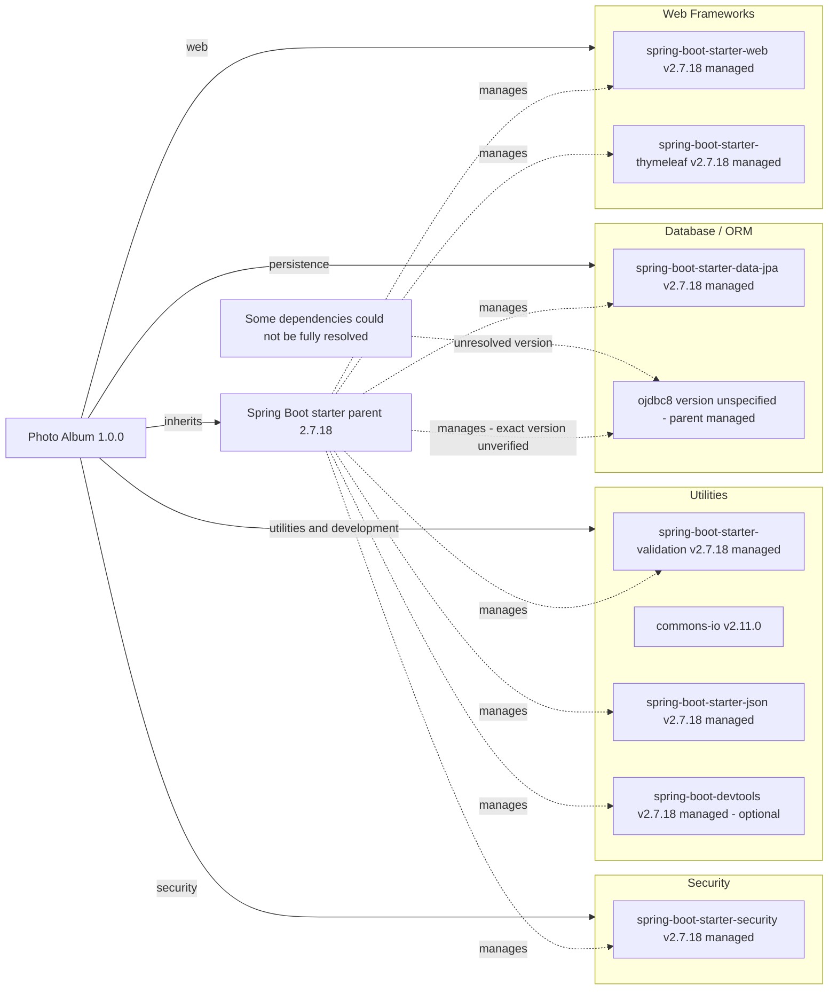

# Dependency Map

Photo Album (`com.photoalbum:photo-album:1.0.0`) declares **11 external dependencies: 9 non-test and 2 test-scoped**. This build-file-only assessment uses [`pom.xml`](../../../../../../pom.xml); the parent POM and build plugin are reported separately and excluded from dependency counts.

## Dependencies

### Dependency Summary

| Category | Count | Key Libraries | Notes |
|----------|-------|---------------|-------|
| Web Frameworks | 2 | `org.springframework.boot:spring-boot-starter-web`, `org.springframework.boot:spring-boot-starter-thymeleaf` — parent-managed 2.7.18 | Both default to compile scope; declarations omit versions (`pom.xml:31–41`). |
| Database / ORM | 2 | `org.springframework.boot:spring-boot-starter-data-jpa` — parent-managed 2.7.18; `com.oracle.database.jdbc:ojdbc8` — version unspecified | JPA defaults to compile; Oracle explicitly uses runtime scope (`pom.xml:43–54`). Oracle's effective version is not available in the local declaration. |
| Security | 1 | `org.springframework.boot:spring-boot-starter-security` — parent-managed 2.7.18 | Default compile scope; version omitted (`pom.xml:62–66`). |
| Utilities | 4 | `org.springframework.boot:spring-boot-starter-validation` — parent-managed 2.7.18; `commons-io:commons-io:2.11.0`; `org.springframework.boot:spring-boot-starter-json` — parent-managed 2.7.18; `org.springframework.boot:spring-boot-devtools` — parent-managed 2.7.18 | All default to compile scope; DevTools is optional, not test-scoped (`pom.xml:56–60`, `68–79`, `95–100`). |
| **Total non-test** | **9** | **4 functional categories** | Test dependencies are listed separately below. |

**Version management and evidence:** `org.springframework.boot:spring-boot-starter-parent:2.7.18` is the declared external parent, with an empty `relativePath` (`pom.xml:8–13`). Spring Boot artifacts without explicit versions are represented using that parent release's managed version; effective management was not resolved. There is no explicit BOM import or local dependency-management block. Only `pom.xml` was found among recognized build/package manifests; no lockfile or local BOM supplied resolved transitive dependencies. Consequently, transitive frameworks, logging implementations, and their versions are not counted or drawn as independently verified dependencies. Oracle and H2 versions remain unspecified rather than guessed.

**Build tooling:** `org.springframework.boot:spring-boot-maven-plugin` is declared without a version (`pom.xml:103–109`); it relies on inherited plugin management and is not an application dependency.

### Version & Compatibility Risks

The build targets Java 8 (`pom.xml:23–26`) and Spring Boot 2.7.18 (`pom.xml:8–13`), a legacy release line outside its original community support window. Moving to Spring Boot 3 or later requires a newer Java baseline (at least Java 17 for Boot 3) and review of the Jakarta namespace transition, particularly for JPA, validation, and web dependencies. Commons IO is explicitly pinned to the older 2.11.0 release (`pom.xml:68–73`); review maintained versions and advisories before modernization. Oracle and H2 compatibility cannot be established without resolving inherited versions. These are compatibility observations, not findings from a vulnerability scan.

### Notable Observations

- Most versions depend on one parent release; only Commons IO has an explicit dependency version (`pom.xml:8–13`, `30–101`). Parent upgrades can therefore affect much of the dependency tree at once.
- The explicit JSON starter is categorized as JSON support, despite the adjacent “Image processing” comment (`pom.xml:75–79`). Its potential overlap with the web starter should be checked against a resolved dependency tree, not assumed from source usage.
- DevTools is optional but has default compile scope (`pom.xml:95–100`), so it remains in the non-test count. Optionality controls downstream propagation; it does not itself declare a test-only dependency.
- Oracle is runtime-scoped while H2 is test-scoped (`pom.xml:49–54`, `88–93`); the build declares different database dependencies for runtime and testing. Build files alone do not establish database behavioral parity.

## Test Dependencies

| Framework | Version | Notes |
|-----------|---------|-------|
| `org.springframework.boot:spring-boot-starter-test` | Parent-managed 2.7.18; no explicit version | Explicit test scope (`pom.xml:81–86`). This is an aggregate testing starter; individual JUnit, Mockito, or assertion-library versions are not visible in the local POM and are not independently counted. |
| `com.h2database:h2` | Unspecified; inherited management, exact version unverified | Explicit test scope; declared as the testing database (`pom.xml:88–93`). |

Total test-scope dependencies: 2

No separate integration-testing, container-testing, or contract-testing library is explicitly declared. The local manifest does not establish test coverage or execution results, and no tests or dependency-resolution commands were run.
